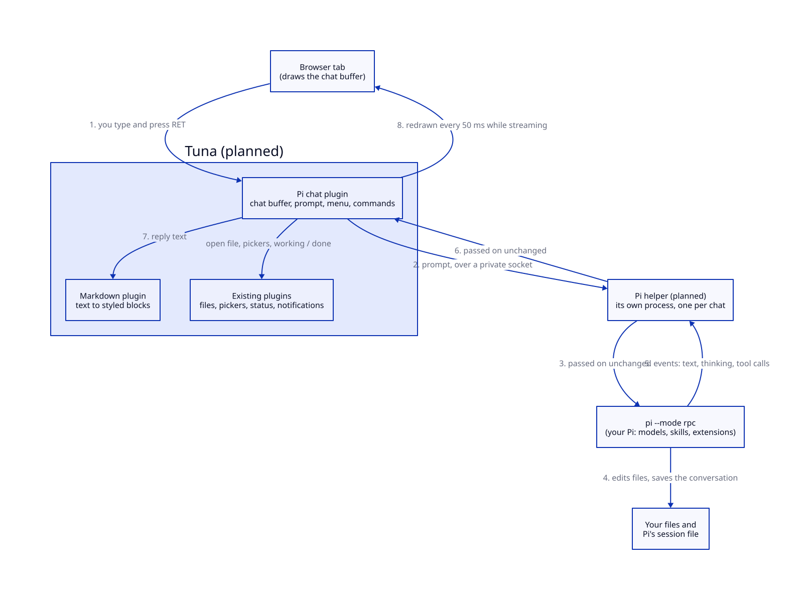
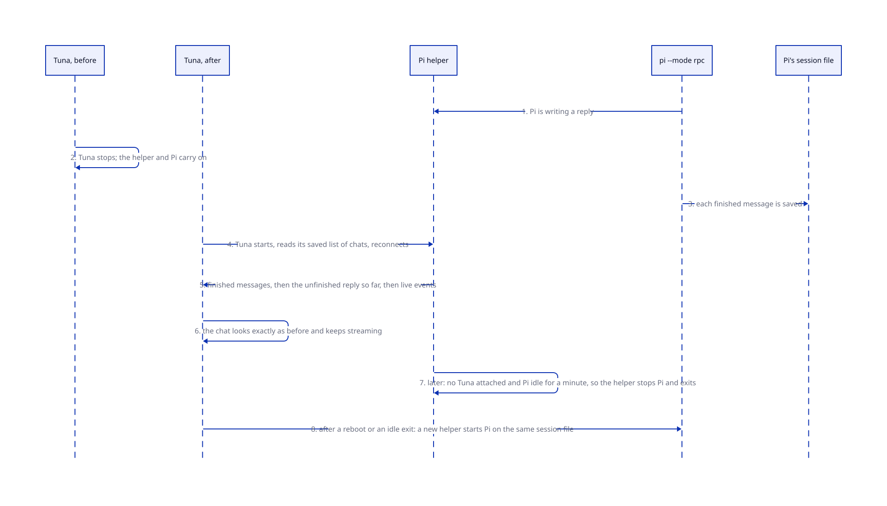

# Brief: a Pi chat in Tuna

**Date:** 2026-10-28. **Status:** written 2026-10-28; the owner pre-approved building it end to end. Plan: [`agents/plans/agent-chat.md`](../../agents/plans/agent-chat.md). Evidence: [`agents/research/agent-chat/`](../../agents/research/agent-chat/) (Pilish, Pi's RPC mode and a helper, Markdown, what Tuna already has). Roadmap: the `llm` plugin.

## What we're building and why

`M-x pi` opens a chat with the [Pi coding agent](https://pi.dev) for the project you're in. It is a Tuna buffer like any other: it scrolls, splits, and you move through it and copy from it with your usual keys. Replies are drawn as real Markdown in a proportional font (headings, lists, tables, links); only code is monospace. You type at the bottom of the same buffer, and your prompt is styled as Markdown while you type.

**It is Pi, not a new agent.** Tuna starts `pi --mode rpc`, Pi's mode for editors, which talks in JSON lines. You get your own models, logins, skills, prompt templates and extensions, exactly as in a terminal. This is what Pilish (Emacs), pi.nvim and pi-dev.nvim do; we copy Pilish's decisions and skip its Emacs workarounds. Pi edits files on disk as always; Tuna's file watcher reloads any open buffer, which `C-/` undoes.

**Chats outlive Tuna.** Pi normally stops when the program that started it exits. Like the terminal, each chat gets a **Pi helper**: a small program, outside Tuna, that holds Pi's connection. When Tuna restarts, Pi keeps working and Tuna reconnects; after a reboot, the chat reopens from Pi's own session file. None of the prior art does this; Tuna restarts far more often than Emacs or VS Code, and the terminal already solved the hard parts.

## The picture

**Status:** planned; nothing in either diagram exists yet.





## A walkthrough

1. **You run `M-x pi` in `~/Code/tuna`.** The chat plugin starts a helper, which starts `pi --mode rpc --approve --model <your default> --thinking low` in that folder. A `*pi: tuna*` buffer opens with the cursor in the prompt.
2. **You select a function in `plugin.ss` and run `pi-send-region`.** One chat is open, so the selection goes straight into its prompt as a quoted block headed `plugins/terminal/plugin.ss:540-562`. With several chats, a picker asks which.
3. **You type "why does this hang? see @"**; typing `@` opens a file picker, and you choose `tests/terminal-test.ss`. You press `RET`.
4. **Pi works.** Its thinking streams in, folded once it's done. Each tool call is a block: `read plugins/terminal/plugin.ss`, `bash make test` with its last five lines of output, `edit plugins/terminal/plugin.ss` with the diff. `RET` on a block's path opens that file at the line. The bar above the prompt says `gpt-5-mini · low · running bash · 23% · $0.04`.
5. **While it works you type a correction and press `RET`.** It is queued; Pi reads it when this turn ends (`M-RET` would hand it over after the current tool instead).
6. **You restart Tuna.** The reply keeps streaming in the helper. Tuna comes back, reconnects, and the chat looks exactly as it did, still streaming.
7. **Pi finishes while you're in another buffer.** The tab shows the chat as done and a notification says so, as for a terminal program.
8. **`C-c C-p` opens the chat menu:** model, thinking level, compact, new, resume, fork, rename, export. You pick a cheaper model; it applies from the next message.

## What it looks like

```text
 You
   Why does this hang? see @tests/terminal-test.ss
   > plugins/terminal/plugin.ss:540-562  (8 lines)
 Pi
   ▸ Thinking  (14 lines)
   ▸ read  plugins/terminal/plugin.ss                    0.1 s
   ▾ bash  make test                                    41 s ✓
       … 5 last lines of output …
   ▸ edit  plugins/terminal/plugin.ss  +3 −1
   The hang comes from **the watchdog's helper**: it waits on …
 ─────────────────────────────────────────────────────────────
 gpt-5-mini · low · idle · 23% · $0.04
 ▏Also check the voice test│
```

**Keys.** In the prompt: `RET` sends (queues while Pi is busy), `S-RET` new line, `M-RET` steers, `C-c C-k` stops Pi, `M-p`/`M-n` earlier prompts, `@` file picker, `C-c C-p` menu. In the transcript: `TAB` folds a block, `RET` opens the file at point, `n`/`p` move between your messages.

**Pi's questions.** When an extension asks something (a choice, a yes/no, some text), a question appears in the chat with an "answer" button that opens the ordinary picker; it never steals focus, and the chat shows as blocked until you answer. Status texts from your extensions appear in the bar.

## A code sample (package author's view)

Your `init.ss` picks the default for new chats; the menu changes a chat's model for that chat only:

```scheme
(use-plugin pi model: "openai/gpt-5-mini" thinking: 'low)
```

Another plugin hands text to a chat through the pi contract, without knowing how chats work:

```scheme
(pi-add-to-prompt! (pick-chat) (format "```\n~a\n```\n" output))
```

## Settled by the evidence

- **Pi's own queue, not ours.** Pilish's own follow-up queue caused about a dozen race fixes; Pi now queues follow-ups and steering itself and reports the queue, so Tuna only displays it. "Pi is idle" means Pi's `agent_settled` event, not `agent_end`.
- **Markdown: md4c**, a small, fuzzed C parser (MIT, CommonMark plus GitHub tables, task lists, strikethrough, autolinks), in a new workbench repository `gerbil-md4c` linked like `gerbil-libghostty`. Raw HTML in a reply is shown as text, never as markup, and only `http`, `https` and `mailto` links open. While a reply streams, Tuna re-parses it every 50 ms and redraws only the blocks that changed.
- **Code blocks are monospace with no colouring yet.** Highlighting comes later through the highlight layers Tuna already has.
- **The transcript is real text you can move through.** Paragraphs, list items and code are read-only text nodes, so the cursor, selection and copy work; only the prompt is editable.
- **The helper is a small Gerbil program, one per chat.** It passes Pi's lines through unchanged and remembers only what a reconnecting Tuna can't ask Pi for: the reply still being written, running tools, open questions, the latest queue and status texts. With no Tuna attached and Pi idle for a minute, it stops Pi and exits. The terminal's private code for starting a helper and its private socket moves into a shared process library, which ADR 18 planned for the second user.
- **The menu lives in the chat plugin** (single-key choices in the minibuffer, like Emacs's transient). It becomes a shared `menus` plugin when a second plugin wants one.
- **Status and notifications are keyed by buffer.** Today they accept only terminals; they will accept any buffer, so the terminal and the chat feed them the same way.
- **Pi only, in a plugin named `pi`** (owner, 2026-10-28). Other agents (Claude Code, Codex, Gemini) all speak ACP, the Agent Client Protocol, natively or through an adapter; if wanted later, a separate `acp` plugin covers them all, and the chat buffer code both share moves into a common library then, not before.
- **Not in the first version:** pictures in prompts and replies, a session tree browser (Pi has no command to move within a session's tree; Pilish rewrites session files to do it), extension widgets, approving edits before they happen, and sending an error log (Tuna has none yet).

## Decisions for the owner

None open. Settled with you on 2026-10-28: Pi's RPC mode with your own `~/.pi/agent` and `--approve` (Pilish's default); Pi keeps working across restarts; the prompt at the bottom of the chat buffer; edits made by Pi on disk; no Tuna extension inside Pi.

## New terms

- **Pi helper:** the small program that holds one chat's Pi, outside Tuna, so Pi keeps working while Tuna restarts.
- **RPC mode:** Pi's mode for editors: commands in and events out, one JSON object per line.
- **Transcript:** the read-only part of a chat buffer, above the prompt.
- **Chat menu:** the transient-style menu of chat commands, one key per choice.
