# Brief: the architecture skeleton

**Date:** 2026-10-11. **Status:** approved 2026-10-11. Agent plan: `agents/plans/architecture-skeleton.md`.

## What we're building and why

The first working Tuna. It does very little editing, but every important part of the architecture is real and gets exercised: the small kernel, plugins that can be turned off and swapped while Tuna runs, the editor thread, `C-g`, commands that ask questions, slow background work, saving your session, and the secure browser connection. If a decision in the architecture records is wrong, this is where it shows up, while it's still cheap to change.

The code is meant to be kept, not thrown away. The kernel is the real kernel; the default plugins are small first versions that later milestones grow; the toy plugins stay as tests.

## The picture

**Status:** planned.



The kernel stays fixed. Everything else is a plugin. Three slots have a second, deliberately tiny plugin you can swap in while Tuna runs, to prove that the default has no special access: a plain-string text store, a plain-text renderer, and a window manager that shows the same buffer in two windows.

The existing diagrams show how [typing a letter](../diagrams/typing-a-letter.svg) and [asking a question](../diagrams/asking-a-question.svg) will work; the skeleton builds exactly those paths.

## Walkthrough: what you'll be able to do

1. Run `make run`. Tuna prints a link with a secret token. Open it in an ordinary browser tab. Opening the page without the token is refused.
2. You see a `*scratch*` buffer with a cursor and an echo area. Type, delete, and move with the arrow keys, `C-f`, `C-b`, `C-p`, `C-a`, and `C-e`. (`C-n` is also bound, but an ordinary browser tab keeps it for itself; the down arrow does the same.) Positions count from 1.
3. Type some digits. They appear immediately; a deliberately slow fake highlighter colors them about a third of a second later. Keep typing fast and the colors still land on the right characters.
4. Press `C-c r`. The minibuffer asks "New name:". Type `notes` and press Enter; the buffer is renamed. The editor kept handling your keys while the command waited.
5. Press `C-c l`, which starts a command that loops forever. Press `C-g`. It stops, and Tuna keeps working.
6. Swap the slots while you work: `C-c s` switches between the rope and the plain-string text store, `C-c v` between the HTML and plain-text renderers, `C-c w` between one window and two windows. In the two-window version, each window has its own cursor on the same buffer. Your text survives every swap.
7. Press `C-c p` to turn the basic-editing plugin off: typing and the motion keys stop working. Press it again and they come back. (The demo commands live in a separate plugin, so you can always turn editing back on.)
8. Press `C-h s` (describe services) to see which plugin fills each slot and which plugins depend on it.
9. Open a second tab with the same link. Both tabs show the same screen.
10. Stop Tuna and start it again. Your text, buffer name, and cursor position come back.

Behind the scenes, automated tests also check the things that are hard to see by hand: two plugins binding the same key survive being turned off in either order; a temporary setting made by one command is invisible to another command waiting at a prompt; and the time from key press to updated screen is measured.

## What it looks like to write a plugin

Illustrative; names will be settled as they're built. This is roughly the demo plugin's fake highlighter and its rename command:

```scheme
#lang :tuna

(defcommand (rename-buffer)
  "Give the current buffer a new name."
  (let (name (read-string "New name: "))    ; waits; the editor keeps running
    (set-buffer-name! (current-buffer) name)))

(keymap-set global-map "C-c r" rename-buffer)

(add-hook after-change-hook 'slow-highlight
  (lambda (buffer)
    (start-job (list 'highlight buffer)        ; a newer job replaces this one
      input: (text-snapshot buffer)            ; free: the text is never copied
      validity: 'rebase                        ; shift results past later typing
      run: (lambda (text) (thread-sleep! 0.3) (digit-ranges text))
      apply: (lambda (ranges) (set-highlights! buffer 'digits ranges)))))
```

Everything this file adds (the command, the key, the hook, any running job) is undone when its plugin is turned off.

## How the work is staged

Each stage ends with something you can try in the browser. I'll stop after each one so you can look before I continue.

| Stage | You can try |
|---|---|
| 1. Kernel and connection | Steps 1, 5 (on a static screen), 8, 9 |
| 2. Text and editing | Steps 2, the text-store half of 6, and 7 |
| 3. Questions, settings, and slow work | Steps 3 and 4 |
| 4. Swaps and saving | The rest of 6, and 10; latency numbers |

Not in the skeleton: opening and saving files, more than one buffer, `M-x`, completion, real highlighting, modes, real window management, and the layout research.

## Decisions for you

None required. Defaults I've chosen, which you can override:

- The skeleton is kept and grown, not thrown away.
- Demo commands live under `C-c` and `C-h s`, in a separate demo plugin that later goes away.
- I stop for your review at the end of each stage.

## New terms

- **Slot**: a named service that one plugin fills at a time, such as the text store.
- **Toy plugin**: a deliberately tiny second plugin for a slot, kept to prove that the slot can really be swapped.
- **Stage**: a step of this milestone that ends with a demo.
