# Brief: buffers, views and layout

**Date:** 2026-10-13. **Status:** proposed; waiting for your approval. Research: `agents/research/layout-state/` (how to store the trees, with Gerbil measurements) and `agents/research/window-management/`. Your vision: `docs/ideas/window-management.md`, "One tree all the way down".

## What this is and why

Everything on Tuna's screen should be one tree you can see and move around in. Buffers are pieces of UI. A file being edited is a buffer, and so are a magit status page, a sidebar of buttons pinned to the left as in VS Code, the minibuffer and the echo area. A layout of containers arranges them on screen: splits, tabs and, later, scrolling strips.

Today Tuna has one window filling the screen, and the minibuffer, echo area and help panel are drawn as special cases. The buffers plugin is also replaceable only on paper. A different buffers plugin could change where the list of buffers is kept, but editing, undo and the record of changes are fixed code that every plugin calls directly (audit finding P1-1).

This work does three things:
- settles the names;
- makes buffers truly replaceable;
- builds the layout, so a VS Code-style screen can be assembled from ordinary buffers.

## The picture


You see one tree, but two plugins own the pieces in memory:
- **The layout plugin owns the layout.** That's the containers and the views in them. The layout is small, about 50 parts, so it's a frozen value: each change makes a new one that shares the unchanged parts. Snapshots are free, which later gives you saved arrangements and an Emacs `winner-mode`-style "undo my last layout change".
- **Buffers plugins own buffers.** A rich buffer can have 100,000 parts, so buffers are changed in place. Each change stamps the changed part, and the parts above it, with a new revision number.
- **The renderer stitches the two together.** It walks the layout, and inside each view it walks that view's buffer. Every redraw sends the whole visible screen, which is your immediate-mode rule. A part whose revision hasn't changed reuses the HTML it produced last time instead of computing it again.

Two owners keep things replaceable. One buffer can appear in several views, a buffer exists when it isn't shown, and either plugin can be swapped without disturbing the other.

## Frames: where you're looking

A **frame** points at any part of the tree, and the browser tab draws that part and everything under it. The part can be a container, a view, or a node inside a buffer. Moving the frame changes where you're looking, not what's there:
- **Point the frame at one view of a split,** and you see only that buffer, full size. The split is still there.
- **Point it at one of two tab groups,** and you see only that group.
- **Point it at one org heading or magit section,** and you see only that part. This makes Emacs's narrowing (`C-x n n`, `org-narrow-to-subtree`) the same feature as moving the frame.
- **Move it back up,** and the larger arrangement reappears untouched.

You can save frame locations as **frame marks** and jump back to them. A frame mark points at a part of the tree, not at a path like "the second child of the first split", so it keeps working after you rearrange things. Emacs comes closest by saving a window configuration to a register (`C-x r w`), but that stores a copy, so jumping back undoes later changes. Jumping to a frame mark only moves the frame.

Tmux's zoom and i3's fullscreen are narrow versions of this: they can enlarge one pane, but they can't stand at any level of the tree. The idea is from your notes in `agents/research/owner-notes/window-layout-topology.org`.

## A walkthrough



1. **You turn on a "buffer list" plugin.** It makes a buffer, `*buffers*`, holding one button per buffer. It asks the layout to show that buffer on the left side. The layout plugin builds a new layout in which a left-to-right container holds the new view (20% wide) and your existing tabs.
2. **The next redraw** walks the layout from the top. At the `*buffers*` view, it walks that buffer's buttons. Nothing in `notes.txt` changed, so its HTML is reused, and the whole screen is sent to the browser.
3. **You switch to the sidebar and back.** The left-to-right container remembered that you were last in the tabs, and the tabs container remembered `notes.txt`. Focus returns to the right place because focus is stored in the layout.
4. **You open a new buffer.** The buffer-list plugin's hook adds a button. That stamps a new revision on `*buffers*`, so only the sidebar's HTML is recomputed. The whole screen is still sent.
5. **A command asks a question.** The minibuffer view appears at the bottom of the tree. It's an ordinary view of the minibuffer's buffer, not a special case, and it goes away when you answer.
6. **You zoom in on `notes.txt`.** The frame moves down to that view, so the screen shows only `notes.txt`. You save this spot as a frame mark, zoom back out, and the sidebar and tabs reappear unchanged. Later, one key jumps you back to the mark.
7. **You turn the buffer-list plugin off.** Its buffer is removed, and its view closes because it was made only for that buffer. The layout goes back to the tabs alone.

## A code sample (package author's view)

The buffer-list sidebar from the walkthrough:

```scheme
(defplugin (buffer-list-sidebar ctx)
  "Lists buffers in a view pinned to the left."
  requires: [buffers-service layout-service]
  (let (sidebar (new-buffer "*buffers*" (new-node 'button-list)))
    (def (refresh!) (set-node-children! (buffer-root sidebar)
                                        (map buffer-button (buffer-list))))
    (refresh!)
    (context-add-buffer! ctx sidebar)                       ; removed when the plugin turns off
    (context-add-hook! ctx buffer-list-update-hook 'sidebar refresh!)
    (display-buffer sidebar side: 'left size: 1/5)))        ; a hint the layout plugin interprets
```

The Emacs version is `(display-buffer buf '(display-buffer-in-side-window (side . left) (window-width . 0.2)))`. Treemacs and speedbar draw their sidebars this way, so a port changes names, not structure. A layout plugin with no idea of sides puts the view wherever it chooses, so the hint never breaks. Names are illustrative.

## How it gets built

Each stage runs in the browser:
1. **Names and the buffers contract.** The renames happen first. Then editing, undo, the record of changes, highlights and node creation go through the buffers contract, instead of being fixed code. Swapping buffers plugins carries your buffers over instead of starting from a fresh `*scratch*`. A small second buffers plugin, used only in tests, proves the contract. The screen looks the same as today.
2. **The layout plugin.** It replaces the one-window plugin:
   - "fit" and "tabbed" containers, each horizontal or vertical (a vertical tabbed container has its tabs down the side), with focus remembered in each container;
   - split, close, and move between views (`C-x 2`, `C-x 3`, `C-x 0`, `C-x o`);
   - `display-buffer` with side hints;
   - moving the frame (zoom in, zoom out, onto a node inside a buffer) and frame marks; the renderer starts drawing at the frame;
   - the layout is saved across restarts as plain data, and each plugin rebuilds its own buffers from its own state.
3. **Everything on screen is the layout.** The minibuffer, echo area and help become views. The renderer draws only the layout tree, and it reuses the HTML of unchanged parts.

**Not in this work:**
- scrolling containers, and drawing only what's in view (their own brief, with the research on how the browser reports what's visible);
- clicking buttons;
- files;
- several browser tabs, each with its own frame. The model already allows it, but it waits for per-tab input.

Focus has two parts. The frame holds the view you're in, and each container remembers its last-focused child, so moving the frame into a container lands where you were. With one frame these never conflict. When several tabs share containers, their focus memories could collide; that's settled with per-tab frames.

So that drawing only what's in view can come later without changing the contract, any tree can hand the renderer just children 200 to 260.

The kernel gains nothing. There's no shared tree library yet, because the two trees want different storage. After approval, the names and the divergences from Emacs go into an ADR, `docs/emacs-equivalents.md` and the overview's glossary.

## Already settled by you

- Rendering is immediate mode: whole screen, every redraw, never patches of single parts.
- A buffer is generically a piece of UI. Saving to a file belongs to text linked to a file, not to buffers.
- Each container remembers its last-focused child.
- After a restart, each plugin's state is saved and the UI is rebuilt from it, never the UI itself.
- The minibuffer and echo area are ordinary parts of the tree.

## Decisions for you

**1. What do we call the places that show buffers?**
- **Context:** today Tuna has both a *window* (a slot in the layout) and a *view* (a buffer as one place shows it, with its own cursor and scroll position). Each window holds exactly one view for life, so they are really one thing. In a browser app, "window" also means the browser window.
- **Options:**
  - (a) **one concept, called a *view*;** "window" goes away;
  - (b) a *pane* that holds a view (two concepts);
  - (c) keep *window*, as Emacs does.
- **Recommendation: (a).** An Emacs window is exactly "a buffer shown in one place, with its own cursor, scroll position and history of buffers shown there". A view would be the same thing, so porting is a mechanical rename (`selected-window` → `selected-view`, `window-point` → `view-point`). VS Code uses the same word: its sidebar parts are "views" inside "view containers".
- **The other names:**
  - **Keep *buffer*.** Emacs buffers were never only files: dired, magit and `*Messages*` are buffers. Alternatives like *surface* or *panel* would cost every porter a translation and gain little.
  - **Keep *frame* for the movable pointer a browser tab draws from.** An Emacs frame is the special case that always points at the top of its window tree. *Tab* is already taken by tabbed containers.
  - **Call saved frame locations *frame marks*.** Emacs's plain *mark* is a buffer position (one end of the region), so the full name is always used, never just "mark". *Bookmarks* would clash with Emacs bookmarks, which point to file positions.

**2. One tree on screen, two owners in memory?**
- **Options:**
  - (a) the layout plugin and buffers plugins each own their part, and the renderer presents them as one tree;
  - (b) literally one stored tree, holding containers and buffer contents together.
- **Recommendation: (a).** With (b), a buffer shown twice would have to be copied or shared awkwardly, a hidden buffer would have no place in the tree, and swapping the layout plugin would mean handing over every buffer's contents. The research also found the two trees need different storage to stay fast: frozen for the layout, changed in place for buffers. You still see, draw and navigate one tree.

## Vocabulary

| Word | Meaning | Emacs counterpart |
|---|---|---|
| **Buffer** | A named piece of UI: a tree of nodes. A file, magit, a sidebar, the minibuffer. | buffer |
| **Node** | One part of a buffer's tree. A *text node* holds editable text; any other node (a button, a section) is a *rich node*. | none (text properties, magit sections) |
| **Text** | The characters, their properties and the undo history inside a text node. Kept separate from the buffer so another buffer can show and edit part of it, as in editable search results. Several views of one buffer need no sharing: they are the same buffer. | buffer text (indirect buffers share it) |
| **Layout** | The tree of containers and views that arranges buffers on screen. | a frame's window tree |
| **Container** | A part of the layout that arranges its children, horizontally or vertically: *fit* splits the space, *tabbed* shows one at a time, later *scroll* is a strip wider than the screen. | internal (combination) window |
| **View** | One place in the layout showing one buffer, with its own cursor and scroll. Replaces "window". | live window |
| **Selected view** | The view you're typing in. | selected window |
| **Frame** | A movable pointer to any part of the tree; a browser tab draws from it. | frame, plus narrowing |
| **Frame mark** | A saved frame location you can jump back to. | window configuration in a register, roughly |
| **Revision number** | A counter stamped on a changed part of a buffer and the parts above it. | none |

Words that go away: *window*, *pane*, and the minibuffer's special "focus view". *Point*, *mark* and *region* keep their Emacs meanings.

