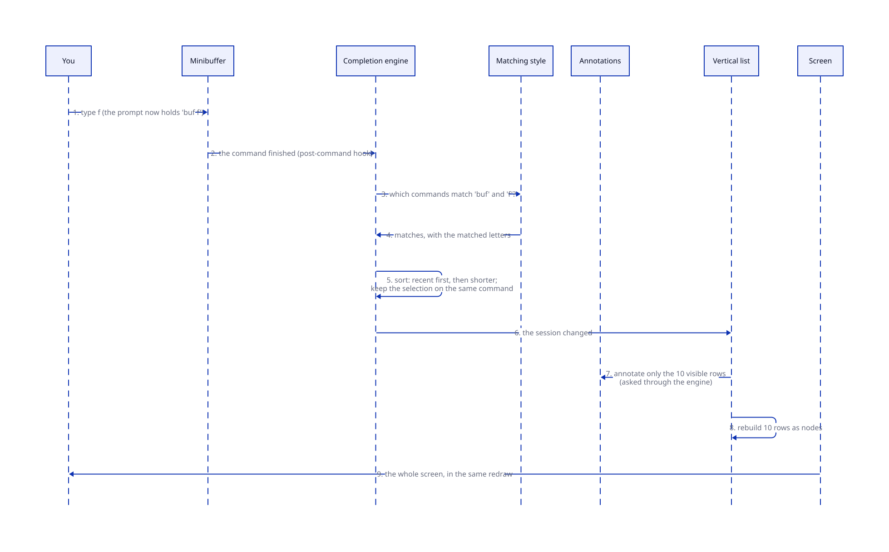

# Brief: completion and M-x

**Date:** 2026-10-13. **Status:** approved 2026-10-13 (candidates as records). Decision record: [ADR 14](../../agents/adr/0014-completion.md); plan: [`agents/plans/completion.md`](../../agents/plans/completion.md). Research: [`agents/research/completion/`](../../agents/research/completion/README.md) (Emacs's `minibuffer.el` and M-x; Vertico, Orderless, Marginalia, Consult and Embark, cloned at pinned commits; every advice and hook they use).

## What this is and why

`M-x` should feel like Emacs with Vertico, Orderless and Marginalia: type a few letters in any order, see a live list of matching commands with their key bindings and descriptions, and press `RET`. Each of those pieces must be its own plugin, used not just by `M-x` but by every later feature that asks you to choose something: a project file picker, buffer switching, help.

Emacs already splits the work this way, which the research confirmed: a core that knows *what* can be chosen, a slot for *how* the list looks, a registry of *matching styles*, and history. The packages fill those slots. But in several places they reach in with **advice** (overriding a core function from outside), because the core lacks a proper place to plug in: Vertico advises `completing-read-default`, and Marginalia advises `completion-metadata-get`. Tuna will provide those places, so none of its plugins needs advice.

## The picture

**Status:** planned.


- **Completion contract and engine:** asks a question with a list of candidates, runs the matching, sorting and history, and keeps a **session** (the running question: what you typed, the matches, the selection). Any feature uses it. Emacs's equivalent is `completing-read`.
- **Vertical list** (like Vertico): one replaceable plugin that shows a session. Swap it, and every question in Tuna looks different.
- **Matching style** (like Orderless): decides which candidates match what you typed. Several can be installed; a setting picks the order, per category if you like.
- **Annotations** (like Marginalia): any plugin can register "for candidates of this category, show this beside them". The engine asks, so any list gets annotations without interception.
- **Commands:** every command with its description and keys, split out of the keys plugin, because `M-x`, help and annotations need commands independent of keys. This answers an open question in the status file.
- **M-x itself is a small plugin:** a command that asks the engine to choose a command, then runs it.



Every keystroke still redraws the whole screen (your immediate-mode rule); the list is ordinary buffer nodes in the minibuffer's view, so it's clickable with the mouse through node keymaps, like buttons.

## A walkthrough

1. **You press `M-x`.** The M-x plugin asks the engine to choose from all commands, category `command`, history `extended-command`. The minibuffer shows `M-x ` and, below it, the first ten commands, most recently used first. Beside each: its key and the first line of its description, from the annotations plugin.
2. **You type `buf f`.** After each key the engine re-runs the matching style: Orderless-like matching keeps commands containing both "buf" and "f", in any order, and highlights the matched letters. The selection stays on the same command if it still matches.
3. **You press `C-n` twice, then `RET`.** The selected command runs as if you'd pressed its keys, and goes to the front of the history.
4. **You turn off the annotations plugin.** `M-x` still works, showing only key bindings (the M-x table's own fallback, as plain Emacs does). Turn off the vertical list too, and it still works as a plain prompt: type a name, `RET`. Each piece adds to the others; none is required.
5. **Later, a project file picker** asks the same engine with category `file`; it gets the same list, matching and history for free, and a file annotator (size, modified time) is just another registration.

## A code sample (package author's view)

```scheme
;; A picker: one call. The result is the chosen candidate's value.
(defcommand (switch-to-recent-buffer) "Choose a buffer to show."
  (switch-to-buffer
   (completing-read "Buffer: "
                    (completion-table 'buffer
                                      (map (lambda (b) (candidate (buffer-name b) b))
                                           (buffer-list)))
                    history: 'buffer)))

;; An annotator plugin: anything of category buffer gets its size beside it.
(defplugin (buffer-annotations ctx)
  requires: [completion-service]
  (context-define-annotator! ctx 'buffer
    (lambda (c) [(annotation (number->string (buffer-size (candidate-value c))) 'size)])))
```

In Emacs these are `completing-read` with a table, and a Marginalia entry in `marginalia-annotators`. The difference: a candidate is a small record holding what's shown and what's returned (`candidate "notes.txt" <the buffer>`), not a string with hidden properties. Names are illustrative.

## How it gets built

Each stage runs in the browser:
1. **Foundations.** The commands contract and plugin (listing commands, their descriptions, running one by name); `where-is` (a command's keys) in the keys plugin; `pre-command-hook` and `post-command-hook`, already decided in ADR 8, pulled forward because the list must update in the same redraw as your keystroke; minibuffer history with `M-p`/`M-n`, saved across restarts; and the test ADR 3 asks for before completion work (a buffer changing while a command waits at a prompt).
2. **The engine, the vertical list, and `M-x`.** Typed candidates, categories, sessions, the UI slot, a simple substring matching style, the list with keyboard and mouse navigation (`C-n`, `C-p`, `RET`, `TAB`, `M-RET` for exactly what you typed, clicking a row), and the M-x plugin. A second, tiny test-only list UI proves the slot is replaceable.
3. **Orderless-like matching and annotations.** Space-separated parts in any order, plain text or regular expressions, with highlighting; the annotations registry and the command annotator (key and description).

**Leave room for, don't build yet:** Consult-style multi-source lists, narrowing and preview; filtering large lists as background jobs; category families (a project file is a kind of file); file name completion; Embark-style actions on candidates; in-buffer completion (Corfu).

The kernel gains nothing. Hooks and advice in general stay a later milestone; this needs only the two command-loop hooks, which already have a decided design.

## Decisions for you

**1. Candidates as records, not strings.**
- **Context:** in Emacs a candidate is a string; packages hide extra data in invisible text properties, and Consult even appends invisible characters to tell apart two candidates with the same text.
- **Options:** (a) strings, as Emacs; (b) a small record: the text you see and match, the value returned (a buffer, a command, a path), and an identity.
- **Recommendation: (b).** Simpler for every list, no hidden tricks, and the chosen thing comes back directly. The cost: ported Emacs code that builds string lists needs a one-line adapter, which Tuna provides. Recorded as a divergence from Emacs.

Decided by the evidence (not questions for you): commands get their own small contract; the list updates in the same redraw through `post-command-hook`, with matching done directly for now and background jobs left as a later switch; `M-x` lists every command except those that hide themselves (like `exit-minibuffer` outside a question), with mode filtering when modes exist.

## New terms

- **Candidate:** one thing you can choose, with the text shown and the value returned.
- **Category:** what kind of thing the candidates are (`command`, `buffer`, `file`); annotators and settings key off it.
- **Session:** one running question: what you've typed, the matches, and the selection. Other plugins can read it (later, to act on the selection, as Embark does).
- **Matching style:** a rule for which candidates match what you typed (substring, Orderless-like).
- **Annotator:** a function that adds information beside each candidate of a category.
