# Brief: your configuration, reloading it, and recovering from mistakes

**Status:** decided 2026-10-12 (see "Decisions" below). Built: starting from `init.ss` (stage 1, 2026-10-12) and reloading it (stage 2, 2026-10-13: the `reload-config` command from the `reload-config-plugin`, bound to `C-c R` in the starter, and `tuna reload`, which talks to the running Tuna over a private Unix-domain socket from Tuna's start-up code, so it needs no plugin). Options and the report inside Tuna (stage 3, 2026-10-13): `(use-plugin p key: value ...)` with options each plugin declares through `defplugin-options`, checked at load with every problem and its line; a one-line summary in the echo area after a start-up with problems; and the `show-config-report` command (`C-c C-r` in the starter), which shows the last start-up or reload report; see [the plan](../../agents/plans/configuration.md).

## What this is and why

Today Tuna turns on a fixed list of 15 plugins written into its start-up code. You cannot choose them, and there is no `init.ss`. This brief describes how you choose your plugins, write your own code, reload both without restarting, and recover when something you wrote is broken.

Four rules shape it:
- **There is no standard setup.** Tuna ships a starter configuration as a file, but nothing ever uses it unless you ask for it, and nothing falls back to it or to any built-in plugin set.
- **No magic.** Tuna never creates, copies or edits your configuration on its own.
- **No stored history.** Tuna never keeps old copies of your configuration. When a reload goes wrong, the running editor is the "last good" version: anything that fails is undone and the old part keeps running. (As built, one exception: a module of your own that `init.ss` imports by path has its definitions replaced when its changed file loads, even if the reload then fails; see `docs/overview.md`.)
- **The kernel does not change.** Loading a configuration only needs "turn this plugin on" and "turn it off", which the kernel already has.

Evidence: [what Gerbil can do](../../agents/research/configuration/01-gerbil-runtime.md) (tested) and [how other systems do it](../../agents/research/configuration/02-prior-art.md): Cordis and Koishi (Tuna's plugin model), Caddy and nginx (check a new config, keep the old one running if it fails), Kubernetes and systemd (one failing part never takes the others down), Doom Emacs and lazy.nvim (plugin declarations inside the config file), Helix, Lem, Nyxt.

## The picture

Starting up:



Reloading:



## Your configuration

One file, `init.ss`. Tuna looks for it in this order and uses the first it finds:
1. the path given with `tuna --config PATH`;
2. the `TUNA_CONFIG` environment variable;
3. `~/.config/tuna/init.ss`.

For local development, `tuna --config starter/init.ss` runs the starter configuration straight from the repository. If no configuration is found, Tuna turns nothing on and says how to get one: copy the starter yourself, or run `tuna init`, which copies it to `~/.config/tuna/init.ss` and tells you so.

`use-plugin` **declares** a plugin; it does not turn it on. Running `init.ss` only collects the declarations and your other code. Nothing is turned on until the whole file has run successfully in a trial run. Then Tuna compares the result with what is running and changes only the difference. This is how Doom's `doom!` block and lazy.nvim's plugin specs work too. Choices that can only be made at start-up, such as how keys work, are declared the same way and take effect at the next start.

Code inside a `use-plugin` block belongs to that plugin. It is applied when the plugin turns on, removed when the plugin turns off, and if it fails, only that block is undone and skipped.

```scheme
;; ~/.config/tuna/init.ss
#lang :tuna/prelude
(use-plugin keys)
(use-plugin web     port: 8001)
(use-plugin buffers)
(use-plugin modal   leader: "SPC"                    ; a package you installed
  config: (keymap-set "C-c t" 'toggle-theme))       ; belongs to modal
(defcommand (insert-date) "Insert today's date."    ; your own code, applied last
  (insert (todays-date)))
```

Names and syntax are illustrative; they will settle as this is built.

## A walkthrough

1. **You add `modal` with a typo in an option** (`leader: SPC` without quotes) and run `reload-config`. The trial run catches it before anything changes: "init.ss line 6: modal option leader must be a string". Tuna keeps running exactly as before.
2. **You fix it and reload.** Tuna compares the declarations with what is running. Only `modal` is new, so only `modal` is turned on; nothing else is touched.
3. **The `config:` code in the `modal` block has a bug** that raises an error. That block is undone and skipped; `modal` itself and everything else stay on. The message names the line.
4. **Next morning you break `modal`, your own input plugin, and restart Tuna.** There is no running editor to keep, so Tuna turns on every plugin it can, skips `modal` and the two plugins that need it, and stays running. You can't type into Tuna, so the report goes to the terminal you started it from and to a log file. You fix `modal` in any editor and run `tuna reload` in a terminal; Tuna reloads as in step 2 and `modal` comes up.
5. **If `init.ss` has a syntax error** (an unbalanced parenthesis), Tuna cannot read it at all, so on a cold start nothing is turned on. You see the error and line in the terminal and the log, fix it, and run `tuna reload`. During a reload the same mistake is harmless: the trial run fails and nothing changes. `tuna check` runs every start-up check without starting anything, so you can catch this before restarting.

## The start-up report

The report lists what came up, what failed and why (file and line), and what was skipped because something it needed failed. It goes to:
- the terminal Tuna was started from;
- a log file in Tuna's state folder, replaced on every start (Tuna never reads it back);
- inside Tuna, once something can show it: if any plugin that can display messages came up, the failures are shown there too, with a command to see the full report again.

## Where configuration lives

Neither inside the kernel nor as a special case:
- **Finding and reading your file, and turning plugins on at start-up,** is done by Tuna's start-up code, the program's `main`, which sits outside the kernel and uses only the kernel's public "turn on / turn off".
- **The reload and check commands** (`reload-config`, and `tuna reload` / `tuna check` from a terminal) come from an ordinary configuration plugin, which you could replace. *As built:* `reload-config` is such a plugin; `tuna reload` and `tuna check` are part of Tuna's start-up code instead, because they must work when no plugin, or a broken one, handles input.
- **The kernel is unchanged.**

## What gets built first

- `init.ss` with `use-plugin`, found through `--config`, `TUNA_CONFIG`, or `~/.config/tuna/init.ss`.
- A starter `init.ss` in the repository and `tuna init` to copy it.
- The trial run, the comparison, and per-plugin and per-block failure isolation.
- Reload from inside Tuna and from a terminal; `tuna check`.
- The start-up report, in all three places.

Later, each with its own short plan:
- narrowing a broken configuration down to the bad part by switching halves off, kept only in memory;
- reloading the code of plugins themselves while Tuna runs;
- installing packages from inside Tuna.

Things to know:
- **Running your code needs part of Gerbil built into Tuna:** the expander, which turns code like `def` and `import` into something runnable. It adds about 1.7 MB and about 80 ms the first time it's used, and can load in the background.
- **Reloading Tuna's own compiled plugins in place does not work in Gerbil;** reloading from source does. That shapes the later plugin-reload work, not this one.

## Decisions

All taken by the owner on 2026-10-12:
1. **One configuration file,** `init.ss`, with a declarative `use-plugin` form, rather than a separate plugin-list file.
2. **No automatic copying.** With no configuration Tuna turns nothing on and says how to get one; `tuna init` copies the starter only when you run it. `--config PATH` and `TUNA_CONFIG` choose the file.
3. **The start-up report** goes to the terminal, a log file replaced on every start, and Tuna's own display when one is available.
4. **A settings screen comes later, not in this work.** It will be like Emacs's `M-x customize`: settings changed through Tuna's interface are saved as plain data in `custom.ss` (ADR 5), and they override `init.ss`. It is on the roadmap.

## New terms

- **Configuration:** your `init.ss`, the one file that says which plugins to use, with what options, plus your own code.
- **Starter configuration:** an `init.ss` that ships in the repository for you to copy or run with `--config`; never used unless you ask.
- **Reload:** run your configuration in a trial run, compare it with what's running, and change only the difference; anything that fails is undone and the old version keeps running.
- **Start-up report:** what came up, what failed and why, and what was skipped because something it needed failed.
