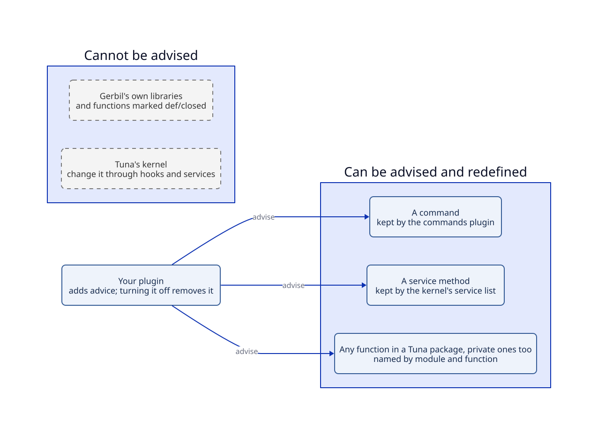
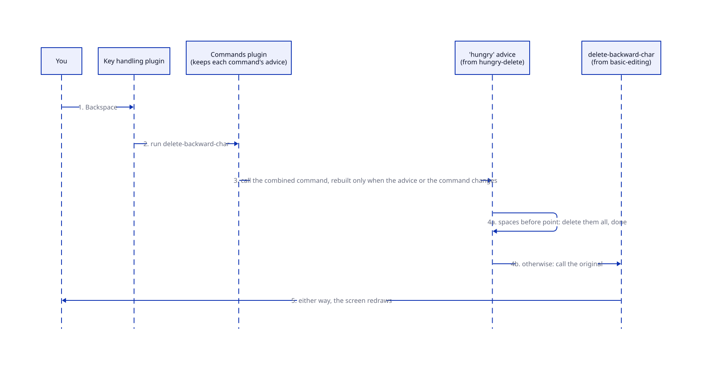

# Brief: hooks and advice

**Date:** 2026-10-15 (revised after three spikes). **Status:** approved 2026-10-15: option (d), open by default, with one `advise!` for functions, commands and services. Plan: [`agents/plans/hooks-and-advice.md`](../../agents/plans/hooks-and-advice.md). Roadmap item 4 of "getting the core back to its intended shape". Research: [`agents/research/hooks-advice/`](../../agents/research/hooks-advice/) ([Emacs](../../agents/research/hooks-advice/emacs.md), [other systems](../../agents/research/hooks-advice/prior-art.md), [Gerbil and Tuna's hooks](../../agents/research/hooks-advice/gerbil-and-tuna.md), spikes [1](../../agents/research/hooks-advice/open-def-spike.md), [2](../../agents/research/hooks-advice/open-def-spike-2.md) and [3](../../agents/research/hooks-advice/open-def-spike-3.md)). Changes [ADR 1](../../agents/adr/0001-language-and-extension-surface.md) and [ADR 2](../../agents/adr/0002-plugins-contexts-and-services.md).

## What we're building and why

Tuna gives plugins and your configuration three ways to change other code's behavior while it runs:

- **Hooks** (built): code announces "this happened", and plugins add callbacks.
- **Advice** (not built): wrapping an existing function or command so that your code runs before, after or around it, as Emacs's `advice-add` does. The profiler needs it to time a function without editing its source.
- **Redefinition** (not really built): replacing a function's definition while Tuna runs, as `C-M-x` does in Emacs.

The goal is Emacs's reach: any function in any Tuna package can be advised or redefined, from your `init.ss`, from a plugin, or interactively.

The research and three spikes found:

1. **Plain Gerbil can't do this.** Gerbil compiles calls to a typed function straight to the original, so a function replaced from outside is never seen by its callers. The only workarounds use undocumented compiler internals.
2. **Tuna's package language can, cleanly.** In modules written in Tuna's package language (`#lang :tuna/prelude`), `def` makes an **open function**: callers always reach its current definition. It takes about 100 lines of documented Gerbil macros in the prelude. All 251 functions in our plugins were opened in a spike, and every test passed. The costs: a clean build takes 16% longer; redraws and key presses are within measurement noise of today.
3. **Private functions are reachable too.** Gerbil can evaluate code inside a particular module, the mechanism its documented `enter!` command uses. Inside the module, its private functions are visible by name. A spike redefined and wrapped private functions of compiled modules, including the real layout plugin, and every caller saw the change.
4. **Proven hot spots can opt out** with `def/closed`, as Emacs code uses `defsubst` for speed.
5. **The rest of Gerbil stays ordinary:** its standard library, other Gerbil libraries and Tuna's kernel are not open. Emacs's C core is the equivalent.

Emacs's manual and the research agree on one more lesson: prefer declared extension points such as hooks to wrapping, and make wrapping visible and owned. Advice in Tuna always has an owner, and `describe-advice` lists who wraps what.

## The pictures





**Status:** planned. Today nothing can be advised, and package functions are ordinary Gerbil functions.

## A walkthrough: a "hungry delete" plugin

1. Your `init.ss` turns on `hungry-delete`. When it starts, the plugin adds **advice** named `hungry`, of the **around** kind, to the command `delete-backward-char`, which belongs to `basic-editing`.
2. The commands plugin records the advice with its owner, name, kind and depth, and builds the combined command once.
3. You press Backspace. The key handling plugin runs `delete-backward-char`, and the commands plugin calls the combined command.
4. The `hungry` advice runs first. If there are spaces before point, it deletes them all and stops (4a). Otherwise it calls the original command (4b).
5. `M-x describe-advice` on `delete-backward-char` lists the advice in calling order: `hungry`, around, from `hungry-delete`, with the place in its source where it was defined.
6. You open `basic-editing`'s source, change `delete-backward-char`, and press `C-M-x`. Tuna evaluates the new definition inside that package's module and replaces the original *under* the advice, so Backspace is still hungry.
7. You turn `hungry-delete` off. Its clean-up removes the advice, and Backspace runs the newest `delete-backward-char` directly.

## What a package author writes

The names are provisional; the forms are settled.

```scheme
;; A plugin advising another plugin's command.
(defplugin (hungry-delete ctx)
  "Backspace deletes all the spaces before point at once."
  requires: [commands-service]
  (advise! ctx (command delete-backward-char) 'hungry
    around: (lambda (original)
              (if (spaces-before-point?)
                (delete-spaces-before-point!)
                (original)))))

;; Any package function, even a private one, by module and name.
;; An imported function can be named directly: (advise! ctx find-node ...).
(advise! ctx (function :tuna/plugins/layout/plugin find-node) 'log-lookups
  before: (lambda (tree id) (log-lookup id)))

;; An operation of a service, whichever plugin provides it.
(advise! ctx (service text-store-service insert!) 'timing
  around: (lambda (original . args) (time-it (lambda () (apply original args)))))

;; A hot inner loop opts out, like Emacs's defsubst.
(def/closed (rope-for-each-chunk f rope) …)
```

## The rules

**Open functions.**
- In Tuna packages, every top-level `def` of a function is open. Non-functions, local definitions, methods and structs are untouched.
- `def/closed` is the opt-out, for functions whose speed is measured to matter.
- A few `def`-like forms from Gerbil's core, such as `def*`, still make ordinary functions. The prelude will cover them too.
- Exports keep doing what they do in Gerbil: deciding what `import` gives you. They don't limit what can be advised or redefined.

**Advice.**
- Each piece of advice has an owner (a plugin, a block of your configuration, or your session for code you evaluate), a name, a kind and a depth. Adding advice with the same owner and name replaces it. Turning the owner off removes it.
- **Scope follows the target, not the registering owner.** Function advice changes the shared package function, just as `redefine` does and Emacs's `advice-add` does. Command and service advice follow their existing registries. Ownership supplies cleanup, not a second copy of the function per editor instance. No new kernel isolation query is needed; [scope evidence](../../agents/research/hooks-advice/advice-scope.md).
- **One form, three targets:** `advise!` takes a function (an imported name, or `(function module name)` for any open function, private ones included), a command (`(command name)`), or a service operation (`(service service operation)`). Service advice wraps the operation for whichever plugin provides the service and survives a swap; function advice wraps one specific piece of code. Both can apply at once; service advice is then outermost. Function targets reach named top-level functions only, so an operation a provider implements inline is reachable only through its service.
- **Kinds:** ADR 1's ten Emacs kinds (`before`, `after`, `around`, `override`, `filter-args`, `filter-return`, and the four `before-while`-style variants). Emacs's newer eleventh kind, which changes only how a command reads its arguments, isn't needed: Tuna commands read their arguments inside their body.
- **Order:** lower depth is outermost. Equal depths go by the owners' order in `init.ss`, not by when the advice was added, so a reload can't reorder them.
- **Errors:** an error inside advice propagates like an error in the function itself, and the report names the advice and its owner. Hooks are different: a failing callback is removed and the rest continue. Silently skipping advice would change what the function returns.
- **Visible:** `describe-advice` lists everything wrapping a function or command.
- **Cost:** advice is combined when it changes, not on every call. The earlier 1–5 ns measurement covered bare forwarding only, not full owned advice. The stage-2 candidate measured about 0.7 µs per owned around-advice call, including error attribution and context restoration; this is being profiled before acceptance. Calls with no advice retain the open-function fast path.
- **Not advisable:** hooks (adding a callback at a chosen depth already does before or after), Tuna's kernel and Gerbil's own libraries, and patterns like "every function matching `foo-*`". The profiler's "profile this plugin" will add a listed set of individual advice instead.

**Redefinition.**
- Interactively, `eval-defun` (`C-M-x`) evaluates the definition inside its package's module, so the new body can use the package's private helpers. It turns `def` into an explicit `redefine`, because a plain `def` there is refused. The new definition replaces the old one for every caller and keeps any advice. Evaluating one definition takes about 0.35 ms.
- From code, to replace a function use `override` advice: it's owned, removable and listed, where a raw redefinition is none of those.
- Hook callbacks already call the current definition of a named function.

**Where it lives.**
- The open-function macros live in Tuna's package prelude, not the kernel.
- Combining advice is a small library outside the kernel.
- `advise!` routes command advice to the commands plugin, which keeps it with the command.
- Service methods need the only kernel change: alongside each service's provider, the kernel keeps an "advised view" of it and hands that out while advice exists. Advice never counts as a new provider, so it doesn't restart anything.

**Hooks: three fixes, nothing new.**
- A callback removed for failing leaves its clean-up note behind. This is the same leak shape as the one just fixed. Remove the note with the callback.
- Equal-depth callbacks run in registration order, so a reload can reorder them (a `TODO.md` item). Order them by their owners' place in `init.ss`, as entries and advice are ordered.
- Correct `docs/emacs-equivalents.md`. Ordinary Emacs hooks stop at a failing function and keep it; only `pre-command-hook` and `post-command-hook` remove it, which Tuna does for every hook. Also record this and the ordering as deliberate divergences.
- **Not added until a plugin needs them:** hooks that stop at the first answer (Emacs's `run-hook-with-args-until-success`) and per-buffer hooks. The profiler will need a way to time each callback; that comes with the profiler.

**Known limits.**
- Functions that return "a value or `#f`" already lose proper tail calls because of a Gerbil bug (in `TODO.md`). Opening them adds two stack frames per recursion. Nothing new breaks.
- Typing a character measured 0.015 ms today and 0.030 ms open. That's still far too small to notice; a profile will show whether anything there deserves `def/closed`.

## Decisions for you

1. **Open by default (option d).** Every function in a Tuna package is open, private ones included, with `def/closed` for proven hot spots. *Recommended:* it gives Emacs's reach with documented Gerbil only, and the three spikes found the costs small. **Fallback (owner, 2026-10-15):** if building it turns out complicated or hacky, or starts breaking Gerbil idioms, switch to option (a): only commands, service methods and functions declared with a `defadvisable` macro are open.

## New terms

- **Open function:** a function whose callers always reach its current definition, so it can be advised and redefined. Every `def` in a Tuna package makes one.
- **Advice:** code wrapped around a function or command, owned by a plugin, a configuration block or your session.
- **Advice kind:** when the advice runs relative to the original, for example `before`, `around` or `override`.
- **Depth:** a number placing advice or a hook callback; lower means outermost or earlier.
