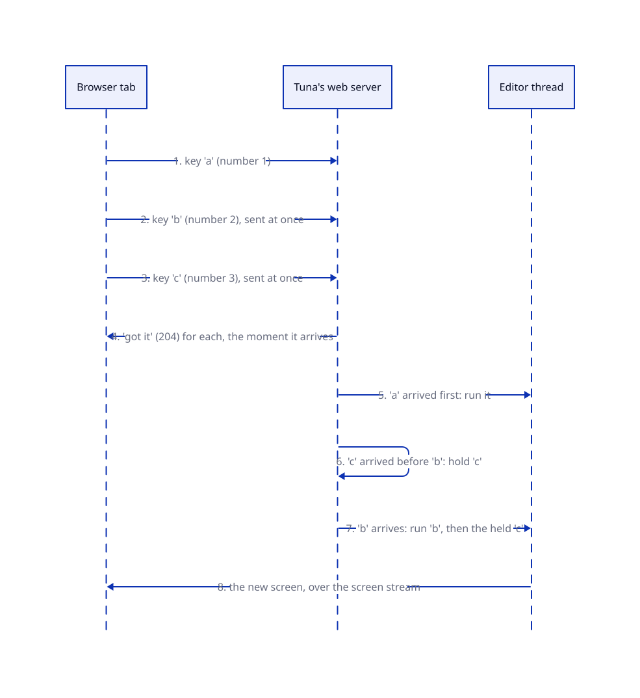

# Brief: send input without waiting

**Date:** 2026-10-14. **Status:** awaiting approval. Changes [ADR 7](../../agents/adr/0007-rendering-and-transport.md) (input) and [ADR 10](../../agents/adr/0010-security-clients-and-trust.md) (client identity).

## What this is and why

Today the browser sends one key press, waits for the server's "got it", and only then sends the next (`plugins/web/frontend/input-queue.ts`: "at most one POST is in flight"). Every key therefore costs a full round trip. At 200 ms of latency you can type at most five keys a second, and fast typing piles up and lags.

The fix, your idea: **the browser sends every key the moment it is pressed, without waiting.** The server puts keys back in order before the editor runs them, because requests sent in parallel can arrive out of order. Your Go terminal (`~/Code/go-web-terminal-singular/example/main.go`, `commandInbox`) already does exactly this; Tuna copies its design.

Two rules stay as they are and get stricter:
- **The server answers "got it" (204) immediately, always:** before running anything, and also for input it rejects (malformed, duplicate, too many waiting). It never answers with an error a tab could act on. All feedback reaches you through the screen stream, because the screen is drawn only from the editor's state.
- **The editor still runs input strictly in the order you typed it.**

## The picture



**Status:** planned. Today step 2 waits for step 1's "got it".

## A walkthrough

1. You type `a`, `b`, `c` quickly over a slow connection. The browser numbers them 1, 2, 3 and sends all three at once.
2. Each request gets "got it" the moment it reaches the server.
3. `a` arrives first: the server hands it to the editor.
4. `c` overtakes `b` on the network. The server holds `c`, because 2 has not come yet.
5. `b` arrives: the server hands over `b`, then the held `c`.
6. The editor runs `a b c` in order and the new screen arrives over the stream.

## How it works (for the implementer, briefly)

- **Numbering.** Each page load picks a random *stream id* and numbers its input 1, 2, 3, …. A new stream id also starts whenever the screen stream reconnects, so the server never has to guess where an old numbering left off (after a reload or a server restart). The tab's client id (ADR 10) stays as it is.
- **Server.** The web plugin keeps, per stream, the next number it expects and the items that arrived early. It hands items to the editor's input queue strictly in order. The kernel does not change.
- **Lost requests.** The browser keeps each item until it gets *any* answer, and resends it with the same number if the network failed. The server ignores a number it has already seen. A stream that has more than 64 items waiting is dropped, and the echo area says some input was lost.
- **Unchanged:** keys and clicks share one numbering, so "type, click, type" stays in order (ADR 7); Datastar's screen stream is untouched.

## A code sample (the browser side)

```ts
// Send at once; the server orders by number. Resend only if the network failed.
function send(item: object): void {
  const body = JSON.stringify({ stream, sequence: ++sequence, ...item });
  const post = () => fetch("/commands", { method: "POST", headers, body })
    .catch(() => setTimeout(post, 250));
  post();
}
```

## Decisions for you

**1. Requests from a tab that is not signed in.**
- **Context:** a tab without Tuna's launch-token cookie has no screen stream, so it cannot be told anything through the screen.
- **Options:** (a) answer 204 like everything else and ignore the input; (b) answer 401/403 as today.
- **Recommendation: (b).** Signed-in tabs always get 204. A tab that is not signed in has no other way to learn that it must open Tuna's link again, and the rejection tells an attacker nothing it does not already know.

**2. What the echo area says when input is lost** (a stream dropped after 64 waiting items, or input the server could not read).
- **Recommendation:** one line, "Some input was lost; type it again", and the details in the log. No retry beyond the resend above.

## New terms

- **Stream id:** a random name for one page load's numbered input, so the server can keep each page's input in order separately.
