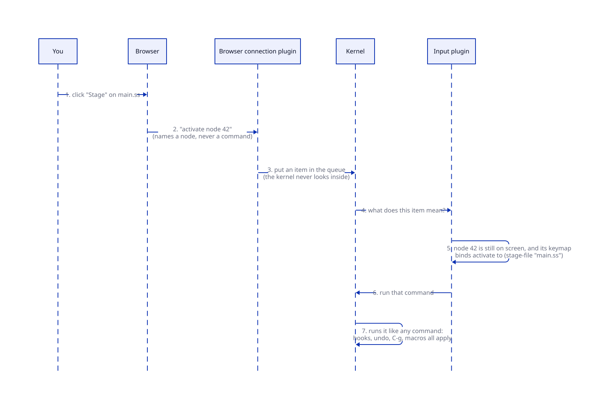

# Brief: the kernel contract

**Date:** 2026-10-12. **Status:** awaiting your approval. Nothing in the code changes until you approve. Research: `agents/research/kernel-contract/` and `agents/research/kernel-audit-2026-10-12.md`.

## What this is and why

Tuna's kernel was meant to be almost nothing: the scaffolding that lets plugins exist. Over the four skeleton stages it grew from about 1,050 to 1,800 lines, picking up a piece of each feature we built: hooks, timers, saved-session slots, a browser keyboard event, and text ranges for the demo highlighter. Your three earlier attempts failed the same way: a feature needs somewhere to keep its data, the central piece is handy, and nobody asks whether a plugin could own it.

This brief fixes that by writing down exactly what the kernel may contain, what it must never know about, and how big it may be. Drift then shows up in a review, or in a failing test, instead of a week later.

## The picture

**Status:** proposed.


There are four layers, and each may use only the layers below it:

- **Plugins** do everything you'd recognize as Tuna: keys and commands, buffers, the minibuffer, windows, drawing the screen, the browser connection, saving your session, the profiler. Tuna's own plugins get no special access.
- **Contracts** say what each slot promises, such as "a text store can insert, delete and read a line", so a different plugin can fill it.
- **Shared libraries** are conveniences built only from the kernel's public parts: timers and background jobs. They hold no special power; a plugin could write its own.
- **The kernel** is three things:
  1. **Plugins:** turn a plugin on and off, undo everything it added, connect it to the services it needs, swap a service's plugin while Tuna runs.
  2. **The editor thread:** one piece of code at a time changes editor state, commands can pause for a question, `C-g` stops them, and input waits in an ordered queue.
  3. **Hooks and IDs:** a named list of callbacks, which is also how the kernel announces its own events ("a plugin turned on", "a command finished"), plus unique IDs.

Cordis, the plugin framework you pointed me to, draws its line in nearly the same place: plugins, effects that can be undone, services, and events in the core; timers and loading in separate packages.

## What the kernel must never know about

Keys, mouse, browsers, HTTP, text, positions, buffers, windows, screens, commands as a list, keymaps, settings, files, saving, timers, profiling, the demo, or the names of any plugin. If kernel code mentions one of these, it's in the wrong place. A check in `make test` searches the kernel for these words and fails if it finds them.

## How input works

**Status:** proposed.



The kernel only knows that "an item arrived". It keeps items in order and hands each one to whichever plugin fills the input slot. That plugin decides what the item means:

- **A key press** is looked up in the keymaps for the current context and mode, as now.
- **A button click** arrives as "activate node 42". The input plugin checks that node 42 is still on screen and looks up what its keymap binds to "activate". When the server drew the button, it bound that to a specific action, for example `(stage-file "main.ss")`.

So a button still runs its specific action, but the browser only ever names a node, never a command. This is how Emacs buttons work, and it's why buttons get help (`describe-key`), rebinding, keyboard macros, undo grouping and `C-g` for free: everything goes through one path. Pressing `RET` on the same button does the same thing. Purely visual things, such as scrolling or opening a disclosure triangle, can stay in the browser and never reach the server.

## What a package author writes

Illustrative; names may change when built.

```scheme
#lang :tuna/prelude

;; A button is just a node whose keymap binds "activate".
(button-node "Stage main.ss"
  activate: (lambda () (stage-file "main.ss")))

;; Listening to the kernel's own events, with no kernel change:
(add-hook command-finished-hook 'my-logger
  (lambda (command) (log-message "ran ~a" command)))
```

## What moves out of the kernel

| Today in the kernel | Moves to |
|---|---|
| Browser keyboard event | The input contract |
| The list of commands | The input plugin, which owns commands and keymaps |
| Timers | A shared library |
| Background jobs (the queueing and replacing) | A shared library; the kernel keeps only "deliver this result to the editor thread" |
| Text ranges and the "shift results past edits" rule | The buffers contract |
| Saved-session slots | Next to the session contract |
| The kernel itself as a public object | Hidden; the browser plugin gets a narrow "submit input" function instead |
| Unused functions (built for decision records, never called) | Deleted until something needs them |

**Target: about 1,250 lines, never more than 1,400** (today 1,800). New kernel functions or data need an amendment to the decision record, and every merge review reports how many lines the kernel gained or lost.

Two cleanups that aren't kernel work come right after this, each with its own short brief:
- **Making buffers really replaceable.** Today the buffers "contract" contains the whole implementation.
- **Taking the demo out of the default startup.**

## Decisions for you

1. **Buttons go through the input plugin and node keymaps** (recommended, as described above), rather than the browser asking the server to run a named command directly. The direct route would be simpler to start with, but it creates a second path where help, macros, rebinding and validation all have to be rebuilt. Do you agree?
2. **Hooks stay in the kernel** (recommended, about 60 lines), because the kernel needs them to announce its own events, which is how outside plugins like the profiler watch it without touching it. The alternative, a hooks library, would leave the kernel no way to announce anything. Do you agree?

## New terms

- **Contract:** what a slot promises, so another plugin can fill it.
- **Shared library:** convenience code built only from the kernel's public parts; it has no special access.
- **Item:** one unit of input from a browser tab, such as a key press or a button activation. The kernel never looks inside it.
