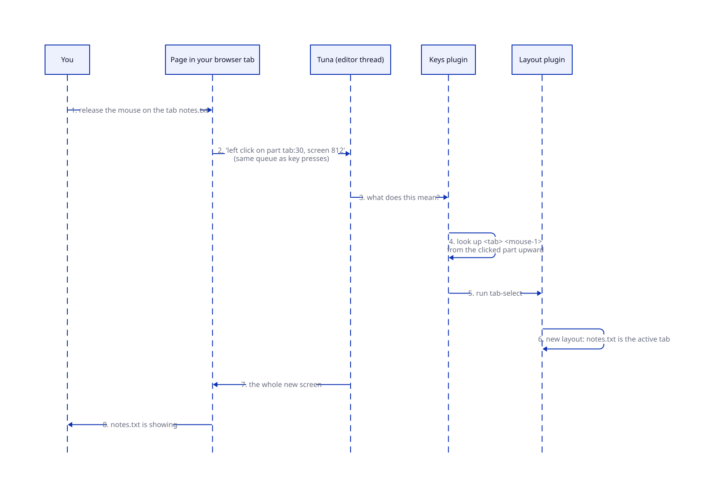
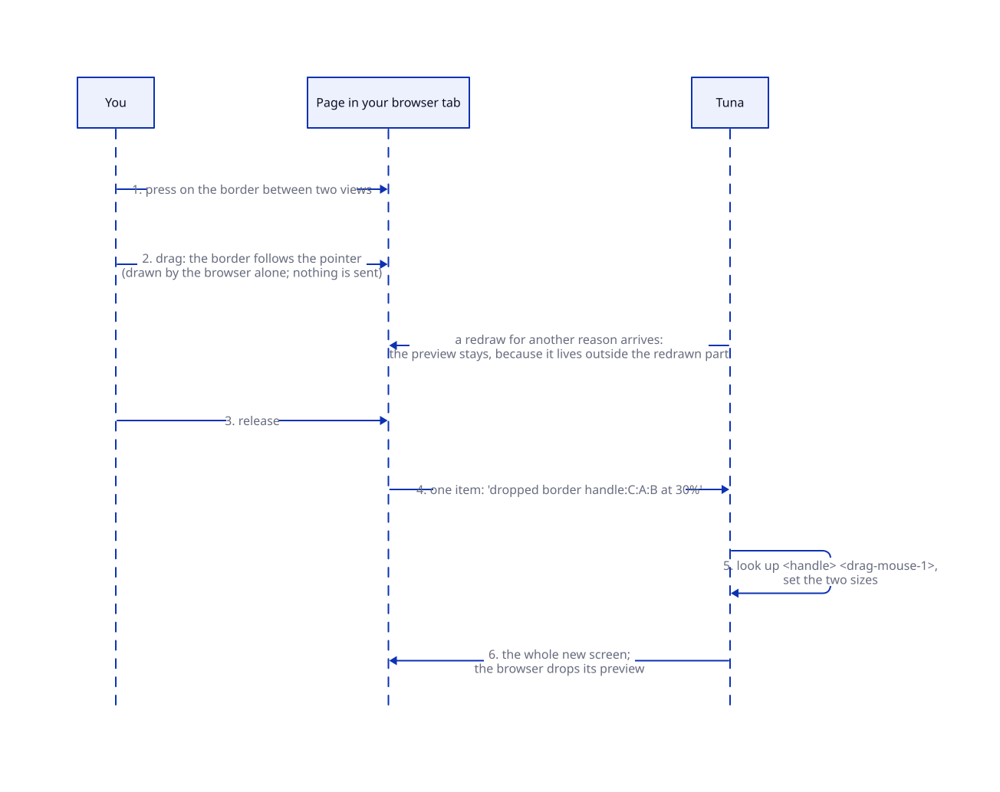

# Brief: mouse input

**Date:** 2026-10-13. **Status:** approved 2026-10-13 with a trimmed scope: clicks and node keymaps only. All dragging (parts, split borders) and the drag-mechanism decision move to the [layout outline](../ideas/layout-outline.md) work, where they belong. Plan: [`agents/plans/mouse-input.md`](../../agents/plans/mouse-input.md). Research: [`agents/research/mouse-input/README.md`](../../agents/research/mouse-input/README.md) (Emacs's mouse model, Datastar idioms) and [`spike.md`](../../agents/research/mouse-input/spike.md) (a throwaway prototype checked in Chrome; screenshots in `/home/jay/Code/workbench-gerbil/scratch/tuna-mouse/`).

## What this is and why

Tuna can only be driven from the keyboard today. This adds the mouse: clicking tabs, views, status lines and buttons in buffers; dragging split borders; dragging tabs to other places. Clicking and selecting inside text comes later.

Three of your decisions shape it:
- **The server processes everything.** A click changes nothing until the server's new screen arrives. The browser owns only how things look while you point and drag.
- **The browser never names a command.** It reports what happened ("left click on this tab"), and Tuna decides what that means.
- **It should look polished.** Hover and pressed styles, pointer cursors, and drop highlights are part of the work, not an afterthought.

## The picture

**Status:** planned. The prototype ran both flows in Chrome.



A click is just another kind of key. It travels in the same queue as your key presses, so "type, click, type" is always handled in the order you did it. On the server it's looked up in keymaps like a key, the Emacs way: Emacs calls a click `mouse-1` and looks it up in the keymaps at the place you clicked, and a click on the mode line is looked up as `mode-line mouse-1`. Tuna does the same with the kind of part clicked: `<tab> <mouse-1>`, `<view> <mouse-1>`, `<status-line> <mouse-1>`. In the prototype a tab click showed its new screen 10 ms later.



While you drag, the browser alone draws the border following your pointer; nothing is sent. When you let go, one item goes to the server, which sets the sizes, and its screen replaces the browser's preview. In the prototype the new screen arrived 3–7 ms after release, with no frame of the border jumping back, and redraws arriving mid-drag did not disturb it.

## A walkthrough

You have two views side by side; the right one is a tab group with `main.ss` and `notes.txt`.

1. **You hover over the `notes.txt` tab.** It lights up and the pointer becomes a hand. That's CSS on parts the server marked as clickable; nothing is sent.
2. **You click it.** On release, the browser sends "left click on `tab:30`, screen 812". The keys plugin looks up `<tab> <mouse-1>` from the tab upward, finds `tab-select` (the layout plugin's binding), runs it, and the next screen shows `notes.txt`. You type immediately, and the letters land in `notes.txt`.
3. **You click the left view.** `<view> <mouse-1>` runs `mouse-select-view`, so it becomes the selected view. As in Emacs, selecting is just what that binding does; another plugin could bind something else.
4. **You drag the border between them** to 30%. The preview follows your pointer. On release one item goes to the server: "dropped `handle:C:A:B` at 0.3". `<handle> <drag-mouse-1>` sets the sizes.
5. **You drag the `main.ss` tab onto the left edge of the left view.** A tab is only a handle for the part it shows, so you are dragging the `main.ss` view. While you drag, the left view's left edge lights up, showing where it would land. On drop, the server puts the view beside the left view in a split. Had you dragged the tab group's strip instead, the whole group would have moved.
6. **You click a tab that a slow command closed a moment ago.** The echo area says "That tab is gone" and nothing else happens. Clicks name parts by identity, never by position, so a stale click can't hit whatever moved into that spot.
7. **You click a button in a sidebar buffer.** The button node has its own keymap binding `<mouse-1>` (and `RET`), so the click runs the button's command. This is the node keymap from ADR 8, not built yet; stage 2 below.

## A code sample (package author's view)

A button in a buffer, and the command it runs:

```scheme
(def (buffer-button b)
  (new-node 'button attributes: [['label . (buffer-name b)] ['buffer . b]]
                    keymap: button-keymap))          ; clicks and RET on this node

(keymap-set button-keymap "<mouse-1>" 'visit-button)
(keymap-set button-keymap "RET" 'visit-button)

(defcommand (visit-button (e : event))
  "Show the buffer named by the button clicked, or the one at point."
  (switch-to-buffer (node-attribute (posn-node (event-start e)) 'buffer)))
```

In Emacs this is `(keymap-set map "<mouse-1>" ...)` on a `keymap` text property, and `(posn-point (event-start e))` in the command. Ported code changes names, not structure. Names are illustrative.

## Rearranging anything

Every part of the layout can be dragged, not just tabs: a view, a tab group, a split, a pinned bar part. A tab is not special; it is one kind of container, and dragging moves parts of the tree, never "tabs".

**Where you grab a part** (handles):
- a view: its status line;
- a tab: the part that tab shows (a view, or a whole split inside the tab);
- a tab group: its tab strip, outside the tabs;
- any other container (a split has nothing visible to grab): select it with `C-x w a` and drag the selected outline, and later the layout outline sidebar ([idea](../ideas/layout-outline.md)).

**Where it lands** (what the highlight shows while you drag), always relative to the part under the pointer:
- an **edge** (left, right, top, bottom): beside that part. If its container already runs in that direction, the dragged part joins it as a sibling; otherwise the two are wrapped in a new split.
- the **middle**: together with that part as tabs. Onto a tab group, it becomes a new tab; onto a view, the two become a new tab group.
- a **tab strip position**: a tab at that position.

A drop is one tree move: the part keeps its size and pin, and a container left with one child stays (it keeps its kind). Locked parts cannot be dragged, and the server marks which parts accept a drop, so the bar refuses. Dropping a part inside itself is refused.

## How it gets built

Each stage runs in the browser:
1. **Clicks.** Pointer items in the ordered queue; Emacs event names (`mouse-1`, `C-mouse-1`, `double-mouse-1`); lookup with the part kind as a prefix; commands read the click with `event-start`, `posn-node` and friends. Clicking a view selects it; clicking a tab switches to it. Views that should never be selected by a click (the echo area) refuse. Parts with a binding are marked clickable, with hover, pressed and pointer styles. Stale clicks report and do nothing.
2. **Keymaps on buffer nodes.** Lookup starts at the clicked (or, for keys, focused) node and walks up through its buffer, view and containers. A demo sidebar of buttons shows it. This also fixes the bug where `RET` still answers a question after you move away from the minibuffer: its keys will belong to the minibuffer's buffer.
3. **Dragging: deferred** to the layout outline work. The design above and the prototype's findings are kept for it.

**Not in this work:** clicking and selecting inside text, touch screens, context menus, the layout outline sidebar (an [idea](../ideas/layout-outline.md) for later), and commands that create nested containers (a known gap in `TODO.md`).

The kernel gains nothing: it already passes input items through without looking inside.

## Decisions for you

None left: dragging and its one decision (the browser's built-in drag and drop or our own pointer handling) moved to the layout outline work.

## New terms

- **Pointer item:** what the browser sends for a click or a drop: which button, which modifier keys, which part, and the screen it was on.
- **Part kind:** what kind of thing was clicked (`tab`, `view`, `status-line`, `handle`), used like Emacs's `mode-line` prefix in key bindings.
- **Clickable:** a part the server marks because a click on it does something; CSS styles exactly those.
