# Brief: Tuna and its plugins, the repository and package layout

**Date:** 2026-10-14. **Status:** proposed; waiting for your approval. Research, with measurements: [`agents/research/package-layout/README.md`](../../agents/research/package-layout/README.md).

## What this is and why

Today everything lives in one package under `tuna/`: the kernel, the start-up program, every contract and every plugin. The plugins don't import each other (`make test` now checks that), but nothing *physical* separates Tuna from its plugins, and in one place Tuna breaks the rule: `tuna/main.ss` names plugins (it imports the web plugin to print the URL and to apply `--port`).

This work makes the divide physical:
- **`tuna/`** is Tuna itself: the kernel, libraries, and the start-up program. It knows no plugin by name and contains no editor concept (no buffers, keys, layout).
- **`plugins/<name>/`** holds each plugin, self-contained: its contract if it defines one, its implementation, its private files, and its tests. Each is its own Gerbil package now, so moving one into its own repository later is just moving a directory.
- **Tests** live in `tests/` beside what they test, split into `unit/` and `integration/` where both exist; cross-plugin tests live in a top-level `tests/integration/`.

Two facts from the research shape it:
- **Built-in plugins already load at start-up from compiled files,** like a third-party plugin; the "link them into the executable" imports in `main.ss` do nothing. Measured: Tuna starts in 824 ms today and 845 ms with everything truly built in, so loading plugins at start-up costs nothing. About 25 ms per plugin goes to Gerbil reading each plugin's compiled interface, linked or not.
- **Gerbil handles this cleanly:** each `plugins/<name>/` gets its own small `gerbil.pkg`, module names stay readable (`:tuna/plugins/buffers/plugin`), one `make` still builds everything, and `gerbil test` finds the nested `tests/unit` and `tests/integration` directories. Gerbil does not stop a package importing something it didn't declare, so `make test` keeps checking the rules.

## The picture

**Status:** proposed.



Arrows point one way: plugins and contracts depend on Tuna, never the reverse. A plugin depends only on contracts, never on another plugin. Someone else's buffers plugin depends on the buffers *contract* package, not on the default buffers plugin.

```text
tuna/                        kernel, libraries, start-up program
  tests/{unit,integration}/
language/                    the package and init.ss language (defcommand, keymap-set, use-plugin)
plugins/
  buffers/
    contract/                its own small package: what any buffers plugin promises
    plugin.ss  …             the default buffers plugin
    tests/{unit,integration}/
  layout/   contract/  plugin.ss  tree.ss (private)  tests/…
  orderless/  plugin.ss  tests/unit/        (uses completion's contract; defines none)
  web/  plugin.ss  embed.ss  web/  frontend/  tests/…
tests/integration/           tests spanning several plugins
starter/  demo/
```

## A walkthrough

1. **You write your own buffers plugin.** Your package depends on `plugins/buffers/contract` only. You never see, build, or load the default buffers code.
2. **Your `init.ss` declares it** instead of the default: `(use-plugin my-buffers-plugin)`. Tuna loads it exactly as it loads its own plugins.
3. **You start Tuna with `--port 8001`.** Tuna's start-up code doesn't know there is a web plugin: the flag means "the web plugin's `port` option", applied by name to whatever plugin the configuration declares. The web plugin announces its own URL through the configuration contract, and Tuna prints the announcements.
4. **Someone adds an import of the layout plugin into the keys plugin.** `make test` fails, naming the file and the rule.
5. **Later, the layout plugin moves to its own repository.** Nothing is renamed; `init.ss` still imports `:tuna/plugins/layout/plugin`.

## A code sample (package author's view)

```scheme
;; plugins/my-buffers/gerbil.pkg
(package: tuna/plugins/my-buffers)

;; plugins/my-buffers/plugin.ss
#lang :tuna/language/package
(import :tuna/plugins/buffers/contract)   ; the agreement only

(defplugin (my-buffers-plugin ctx)
  "Buffers kept my way."
  requires: [text-store-service settings-service]
  (context-provide! ctx buffers-service (make-my-buffers)))
```

Names are illustrative.

## What has to change first (from the research)

- **Two dependency loops** appear only once contracts move next to their plugins:
  - The keys plugin calls the layout contract to turn a click into a view, while the layout contract uses the keys contract's click description. Fix: the layout plugin registers how its parts resolve clicks, through the keys contract; keys asks that registration instead of calling layout. Keys then knows nothing about layout.
  - The package language (`defcommand`, `keymap-set`, `defsetting`) needs the commands, keys and settings contracts, so it can't live inside `tuna/`. Fix: it becomes its own package, `language/`, as drawn; `tuna/` keeps only what start-up needs to read declarations.
- **`main.ss` stops naming plugins:** delete the no-op imports; the web plugin announces its URL through the configuration contract; `--port` becomes a generic "set this plugin's option" applied by plugin name; session saving at shutdown moves into the session plugin, announced through the configuration contract (designed when that step comes).

## How it gets built

1. **Untangle without moving files:** the click-resolution registration, the language package, notices in the configuration contract, `--port` by plugin name, and `main.ss` naming no plugin. Behavior unchanged; `make test` green.
2. **Move:** `tuna/`, `language/`, `plugins/<name>/` (each with `gerbil.pkg`, contract package where one exists, private files, tests), `tests/integration/`; the root `build.ss` makes each package; `starter/`, `demo/` and every import updated in the same change (no compatibility names).
3. **Check:** rewrite the boundary rules for packages: Tuna imports no plugin or contract; a plugin imports Tuna, contract packages, and its own files only; contract packages form no cycle. Pin the web plugin's external dependency (gerbil-datastar).

## Decisions for you

**1. Where do contracts live?**
- **Context:** you want each contract with its plugin. A contract shared by several plugins (completion's, used by the engine, the list, Orderless, annotations, M-x) still needs one home.
- **Options:** (a) all in `tuna/` (simplest, the research's pick, but `tuna/` then defines buffers, keys and layout, which blurs the divide you asked for); (b) inside each plugin's own package (replacements would depend on the default plugin's package, and it creates the loops above); (c) **each contract as its own small package inside its plugin's directory**, as drawn.
- **Recommendation: (c).** It keeps the contract physically with its plugin, keeps `tuna/` free of editor concepts, and lets a replacement depend on the agreement alone. A "package" here is one `gerbil.pkg` file and a directory, built by the same `make`.

**2. `--port`.**
- **Options:** (a) keep `--port` as shorthand that Tuna's start-up code knows means "the web plugin's port"; (b) a general flag such as `--option web-transport.port=8001`, with `--port` gone.
- **Recommendation: (b).** Tuna's start-up code then names no plugin at all. It's a longer command; a shell alias fixes that.

Decided by the evidence (not questions): plugins load at start-up as they already do (no measurable cost); the entry module is `plugin.ss` in every plugin; one repository and one `make` for now.

## New terms

- **Package:** a directory with a `gerbil.pkg` file; Gerbil builds and names its modules together. Here: `tuna`, `language`, one per plugin, and one per contract.
- **Contract package:** a plugin directory's `contract/` package, holding only what any plugin filling that slot must agree on.
