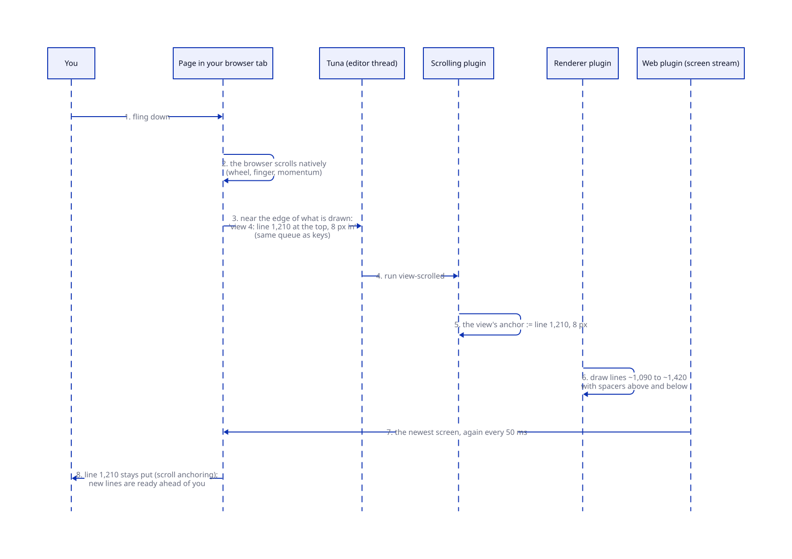
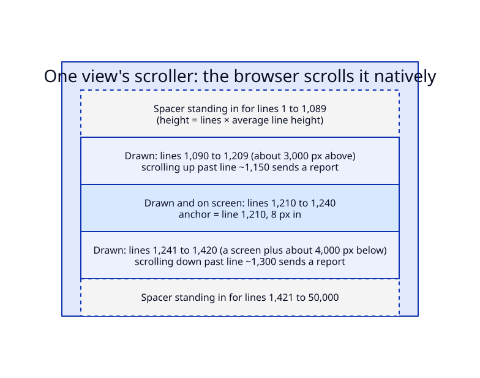

# Brief: scrolling a view

**Date:** 2026-10-17. **Status:** approved 2026-10-17. Research and the working prototype: [`agents/research/scrolling/`](../../agents/research/scrolling/README.md). Plan: [`agents/plans/scrolling.md`](../../agents/plans/scrolling.md).

## What we're building and why

Today every view draws its whole buffer. A 50,000-line buffer costs about half a second of server time per key and megabytes per screen. Views also can't be scrolled by Emacs commands, because the server doesn't know what you can see.

This makes views scroll the way the prototype you tried does, which is hyperlith's virtual scroll adapted to lines of unknown height:

- **The browser scrolls.** Each view is an ordinary native scroller, so wheel, trackpad, finger and momentum feel native on every device.
- **The server draws only what's near you.** It draws about 3,000 px above what you see and a screen plus 4,000 px below. Empty spacers stand in for the rest, so the scrollbar still covers the whole buffer.
- **The server owns where each view is.** Each view stores an **anchor**: the line at the top, and how many pixels into it. That's Emacs's window-start, plus a pixel offset. When you scroll near the edge of what's drawn, the browser reports the line now at the top, and the server redraws around it. `C-v`, `M-v`, `C-l` and point motion move the anchor, and the browser jumps there.
- **Every screen is re-sent every 50 ms,** as hyperlith does, even when nothing changed. A lost screen then costs one tick, not a frozen page. That's what fixed the prototype on your iPhone. The interval is a setting of the web plugin. Brotli compression (roadmap item 8) will make the repeats nearly free.

## The picture

**Status:** planned. The prototype runs this flow, with blocks in place of lines.





## A walkthrough

You open a 50,000-line log in a view 744 px tall.

1. **It opens at the top.** The anchor is line 1, 0 px in. The screen holds lines 1 to about 200 and a spacer for the rest.
2. **You fling down.** The browser scrolls with native momentum. When the top line passes the report point, the page posts "view 4: line 1,210 at the top, 8 px in". That report is numbered and queued like a key press. `view-scrolled` sets the anchor, and the next screen draws lines 1,090 to 1,420. The browser's scroll anchoring keeps line 1,210 exactly where it was while the spacers change size around it.
3. **The fling outruns what's drawn,** and you land in a spacer. The report says how far past the drawn lines you are, and the server counts lines from there using the average line height it has seen, then draws around that line. You saw faint placeholder lines for a moment.
4. **You press `C-n`.** Point was on line 1, now far off screen. As in Emacs, scrolling moved point into view: it's on the top line you see, and `C-n` moves it down one line.
5. **You press `C-v`.** The last line you can see becomes the anchor, and the screen tells the browser to jump there once.
6. **You press `M->`.** Point goes to line 50,000, outside what's drawn. The anchor moves so point's line is in view. The screen draws around it and the browser jumps there.
7. **Your phone drops a screen.** Nothing breaks: the next screen arrives 50 ms later.

## A code sample (package author's view)

`C-v` as the scrolling plugin will define it:

```scheme
(defcommand (scroll-up-command)
  "Scroll the selected view forward by nearly a screen."
  (let (v (selected-view))
    (scroll-view-to! v (view-last-visible-line v))))  ; the browser jumps there

(keymap-set global-map "C-v" 'scroll-up-command)
```

Emacs's version is `(set-window-start (selected-window) (window-end))`. The difference is that `view-last-visible-line` is what the browser last reported, not something the server computed. Names are illustrative.

## Decisions

None are needed from you. I've made two choices that are easy to change:

- **Scrolling with the wheel or finger moves point into view, as in Emacs.** Typing after you scroll edits what you see. A setting, `scroll-moves-point`, turns this off to get VS Code's behaviour, where point stays behind and typing jumps back to it.
- **Only text is drawn partially, for now.** A text node draws only the lines near you; any other node draws whole, which is fine while they're small. Rich buffers with thousands of nodes get the same treatment when the first one is built (roadmap item 4). The mechanism doesn't change; only the unit does.

Out of scope: horizontal scrolling, layout scroll containers (Niri-style strips), and typing on phones (the input proxy).

## New terms

- **Anchor:** a view's scroll position, held by the server: the line at the top of the view and the pixel offset into it.
- **Drawn window:** the lines a view actually draws, around the anchor. Everything else is a **spacer**: an empty block whose height stands in for the lines it replaces.
- **Scroll report:** what the browser sends when you near the edge of the drawn window: which line is at the top, how far into it, and where the drawn lines start and end.
- **Scroll anchoring:** the browser keeps what you're reading still when content above it changes size. Spacers are excluded from it, so it always holds a line, never a spacer.
