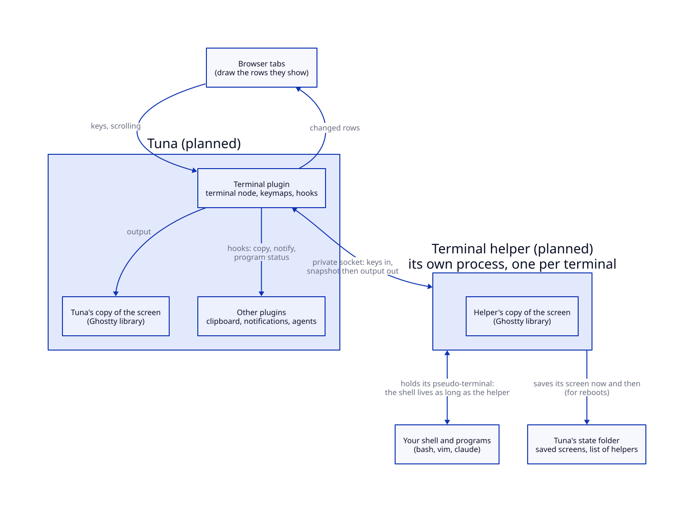
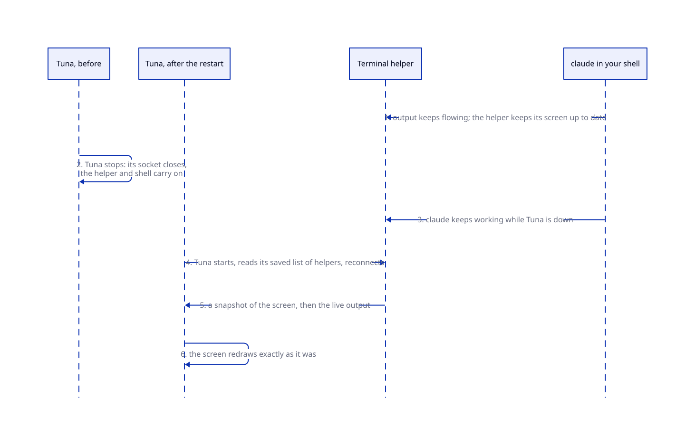

# Brief: a terminal that outlives Tuna

**Date:** 2026-10-27. **Status:** approved 2026-10-27 (owner: make things configurable; follow ghostel closely). Stage 1 (the binding) and stage 2 (a terminal that survives restarts) built 2026-10-27, stage 3 (copy and line mode, the mouse, the clipboard, links) 2026-10-28, stage 4 (programs talking to Tuna: prompts, notifications, program status, shell integration) 2026-10-28, stage 5 (reboots and heavy output) 2026-10-28: the plan is complete; [how it works now](../overview.md#terminals). Plan: [`agents/plans/terminal.md`](../../agents/plans/terminal.md); ADR 18. Evidence: [`agents/research/terminal/`](../../agents/research/terminal/) (ghostel and Emacs's terminals; how tmux-style persistence works; the owner's earlier libghostty work and the binding's gaps; escape codes and browser keys). Roadmap: tier 3, `terminal`.

## What we're building and why

`M-x terminal` opens a shell in a buffer. Full-screen programs (vim, htop, Claude Code) work in it, its scrollback scrolls like any other view, and its colours follow your theme. The engine is Ghostty's terminal library (libghostty-vt), through your Gerbil binding `gerbil-libghostty`.

**Terminals outlive Tuna.** In Emacs, the editor process itself holds each shell's terminal connection (its "pseudo-terminal"), so when Emacs exits, the kernel hangs up and every shell dies. tmux avoids this by keeping shells in a background server that never restarts; your tmux window only views them. Tuna does the same with a **terminal helper**: one small program per terminal, started by the terminal plugin but living outside Tuna's process. It holds the shell and keeps Ghostty's copy of the screen. iTerm2 and herdr (a tmux for coding agents, also built on libghostty) work this way.

- **Tuna restarts, crashes, upgrades or swaps the terminal plugin:** nothing dies. Tuna reconnects to each helper, gets a snapshot of its screen, then the live output.
- **The machine reboots:** every process dies; no tool avoids that. Each terminal comes back in its place in your layout, showing its old screen read-only under a "restored" line, with a fresh shell in the same directory. Commands are never rerun. This is what VS Code, iTerm2, zellij and tmux-resurrect do.

**Programs talk to the terminal with escape codes** (OSC codes): "my title is…", "I'm in this directory", "copy this", "notify the user", "agent is waiting for input" (OSC 7501, Ghostty's program-status protocol, used by Claude Code and Rune). The terminal plugin acts on none of them itself; it turns each into a hook that other plugins answer: the clipboard code copies, a notifications plugin notifies, an agents plugin shows status.

## The picture

**Status:** planned; nothing in it exists yet.





## A walkthrough

1. **You run `M-x terminal`.** The terminal plugin starts a helper for `~/Code/tuna`. The helper starts your shell and holds it. Tuna connects to the helper and keeps a second copy of the screen, so scrolling and drawing never wait on the helper.
2. **You run `claude`.** Output flows from the shell through the helper to Tuna; Tuna redraws only the rows that changed. Keys go to Claude except the few Tuna keeps (`C-x`, `M-x`, …).
3. **Claude asks for permission.** It sends OSC 7501 "waiting". The terminal plugin runs its program-status hook; an agents plugin could badge the tab, and a notifications plugin could alert you.
4. **You upgrade Tuna and restart it.** Claude keeps running in its helper. Tuna starts, reads which helpers it had from its saved session, reconnects, and redraws the screen exactly as it was.
5. **You reboot.** The helper had saved its screen to Tuna's state folder. After the reboot the terminal shows that screen, marked restored, and a new shell starts in `~/Code/tuna`.

## A code sample (package author's view)

A notifications plugin listening to terminals, without knowing anything else about them:

```scheme
(context-add-hook! ctx terminal-notification-hook 'notifications
  (lambda ((term : terminal) (title : string) (body : string))
    (notify! title body source: (terminal-buffer term))))
```

## Settled by the evidence

- **Your binding grows beyond "match the Racket library"** (owner, 2026-10-27). It gets its first commit, then: reading any rows by position without moving Ghostty's own scroll position (each browser tab may look at a different part of the scrollback); scrollback and colour settings; a newer Ghostty pin for OSC 7501; the prompt-mark, reset and redraw-hold effects; later, copying only the rows that changed.
- **Key handling uses the terminal's own keymaps now; modes replace them later** (owner, 2026-10-27). Semi-char (most keys to the program, a short list kept by Tuna), char (every key to the program, one escape key), copy (screen frozen, ordinary editing keys, `RET` copies and leaves) and line (edit locally, `RET` sends), as in eat and ghostel. When modes are built, these keymaps are removed and become terminal modes; [the modes idea](../ideas/modes.md) records this.
- **Colours work like ghostel's.** Ghostel takes the 16 standard colours from your Emacs theme and passes any exact colour a program asks for straight through. Tuna does the same with CSS: the 256 palette colours are CSS variables (the first 16 set by the theme, the rest with standard defaults a theme may override), and exact colours pass through on the text. A program's colours are its content, like an image's pixels, not Tuna's styling, so the "no colours in Gerbil" rule still holds for everything Tuna itself draws.
- **Programs never read your clipboard** through the terminal (OSC 52 read). Copying *to* it works.
- **Browser keys:** a normal tab can't receive `Ctrl-W`, `Ctrl-T` or `Ctrl-N`. Installed as an app (the PWA item in `TODO.md`), Tuna gets them all, as VS Code for the web does. In a tab, `C-q` sends the next key to the program, and closing the tab asks first.
- **Where code lives.** The helper is a small Gerbil program in the terminal package; the plugin owns the terminal node, keymaps, hooks and the saved list of helpers. Nothing enters the kernel. Starting programs on a pseudo-terminal stays in the helper until a second user (search, git) needs it, then moves to the planned process library.

## Decisions for the owner

1. *Decided 2026-10-27: on, and configurable.* **Should the saved screen for reboots be on by default?** Scrollback can contain secrets, such as a token you printed. VS Code and iTerm2 save it by default; herdr and zellij don't. *Recommendation: on*, saved owner-only in Tuna's state folder, with a setting to turn it off. Tuna already autosaves unsaved buffers there, and the restored screen is most of what makes a reboot painless.

## New terms

- **Terminal helper:** the small program that holds one terminal's shell and screen, outside Tuna, so the shell survives Tuna restarting.
- **Pseudo-terminal:** the kernel's connection between a shell and whatever shows it; when its holder exits, the shell is hung up.
- **OSC code:** an escape code a program prints to tell the terminal something (title, directory, "copy this", "notify").
