# Window management: the desired design

**Status:** desired, not scheduled in detail. A brief comes before anything is built. Updated 2026-10-13: see "One tree all the way down". Decision record: [ADR 11](../../agents/adr/0011-window-management-is-a-plugin.md). Research: [`agents/research/window-management/`](../../agents/research/window-management/README.md).

## One tree all the way down (2026-10-13)

The owner's vision, recorded here; nothing below is decided except where marked as the owner's.

- A **buffer** is a named tree of **nodes**: text nodes and other UI nodes. A buffer is the unit that moves together; a magit or dired buffer is a bundle of nodes that moves as one.
- The **layout** is a tree of **containers** (split, tabs, scroll; horizontal or vertical; nested freely, fully composable) whose leaves are **views**. A view is a buffer plus its own state for that place: cursors, scroll, folding.
- The minibuffer and echo area are ordinary leaves of this tree, not special cases. This diverges from Emacs.
- The owner's idea: literally one big tree.
- The architect's proposal (not decided): one tree as you see and navigate it (each view expands its buffer's nodes in place; a browser tab shows any part of the tree you focus), but two owners in the data. The same buffer can appear in several views, buffers exist when not shown, and the layout plugin and buffer plugins must stay separately replaceable.
- Proposed names (not decided): buffer, node, view, container, layout. The word "window" goes away. "Frame" means which part of the layout a browser tab shows.
- Open: how layout and buffer state is stored so changes stay cheap and rendering stays incremental, and whether a generic tree belongs in the kernel, a shared library, or each plugin. Research in progress: `agents/research/layout-state/`.

## The idea

Emacs splits windows one way: a fixed tree of left/right and top/bottom splits, built into its C core. Tuna should let you arrange windows like i3 (splits and tabs), like Niri (an endless strip of columns you scroll through), or any mixture, nested as deeply as you like. And unlike Emacs, the whole window manager is a plugin you can replace.

## One recursive tree

Everything is a **layout tree**. Its leaves are windows, each showing a buffer. Every other node is a **container** that arranges its children in one direction, using one of a few container kinds:

- **Fit:** children share the container's space; their sizes act as weights (i3 and Emacs splits).
- **Scroll:** each child gets a fixed fraction of the container, and if they add up to more than 100%, the container scrolls (a Niri strip).
- **Tabbed:** one child is shown at a time, with tabs (i3 tabs, Niri tabbed columns).

Each child's size is stored on its link to the parent, so a window keeps its size when you move it somewhere else. Plugins can add more container kinds later, such as floating or grid.



That tree produces this screen. The Niri strip on top is wider than the screen, so `*magit*` is off to the right until you scroll to it:

```text
┌───────────────────────┬───────────────────────┐ ┄┄┄┄┄┄┄┄┄┄┄┄┄┄┄┄┄┄┄┄┄┄┄┐
│ main.ss               │ notes.org             │   *magit*             ┆
├───────────────────────┤                       │   (scroll right)      ┆
│ *shell*               │                       │                       ┆
├───────────────────────┴───────┬───────────────┤ ┄┄┄┄┄┄┄┄┄┄┄┄┄┄┄┄┄┄┄┄┄┄┄┘
│ *compilation*                 │ *help*        │
└───────────────────────────────┴───────────────┘
```

Niri itself is this tree with a fixed shape: workspaces are a vertical scroll container, each workspace is a horizontal scroll container of columns, and each column is a vertical fit (or tabbed) container of windows. Emacs's windows are fit containers only, two children each.

A **frame** shows the subtree under one container, so two browser tabs could later show different parts of the same tree.

## Replaceable, Emacs commands still work

Tuna's core knows only a small contract about windows: what windows a frame has, which one is selected, splitting, deleting, moving to a neighbor, saving and restoring arrangements, and choosing a window for a buffer (Emacs's `display-buffer`). Standard commands such as `C-x 2`, `C-x 0`, and `C-x o` use that contract, so they keep working whichever window manager you install.

The layout tree above is Tuna's default window manager, a plugin. Commands that only make sense for it, like Niri's "pull the next window into this column", come with it and disappear if you swap it out. When you switch window managers, the old one hands over a plain list of your windows and what they show, and the new one arranges them its own way.

## Does this need ideas beyond Emacs?

Yes. Emacs's way of customizing is to redefine functions and add hooks. That can change behavior, but it can't cleanly swap a whole subsystem: other code still depends on the old subsystem's state, and nothing tells it the subsystem changed. Swapping needs four things:

1. a contract that the rest of Tuna uses;
2. a way to remove everything the old window manager added;
3. a way for plugins that depend on it to notice the change;
4. a way to carry existing windows across.

Tuna's plugin design already has the first three, taken from Cordis (services, receipts, and dependents that restart when a service changes). The fourth, handing windows from the old manager to the new, is the piece added specifically for window management.

## Open questions for the design brief

- How Niri's "keep the focused column in view with the least motion" behavior works when the browser, not the server, does layout (part of the layout research in the roadmap).
- Where "which window was I last in, inside this container" is remembered, so moving back into a column returns you to the same window.
- Whether scrolling containers use native browser scrolling, scroll snapping, or a Rocket component.
- Default key bindings for the window layer (Weevil used Super).
