# How Tuna works

**Status (2026-10-23):** scrolling (below) is built, with the browser's own scroll bar. The architecture skeleton, the buffers, views and layout work, the kernel's alignment with Cordis, and the split into one package per concept are complete. Built: the small kernel (plugins with receipts, one plugin per service, swapping a service's plugin by restarting and restoring saved data, the editor thread with `C-g`, hooks; cut back on 2026-10-12 to the four things described [below](#a-small-kernel-and-a-lot-of-plugins)), the loopback browser connection, key handling, buffers as node trees with an editable text node, a swappable text store (a rope by default), editing with undo, the echo area and minibuffer with `read-string`, temporary settings, timers, background jobs, a swappable renderer (HTML, the only presentation language; a bare second HTML renderer proves the slot can be swapped), buffers as a replaceable service (editing, undo and highlights live in the buffers plugin; a toy buffers plugin proves the slot), the layout (splits, tabs, a movable frame with frame marks, pinning, and the minibuffer and echo area as ordinary views; a toy two-view layout proves the slot), saving your session and unsaved text across restarts, and starting from and reloading your `init.ss` (stages 1 and 2 of [the configuration plan](../agents/plans/configuration.md): `use-plugin` declarations, `config:` blocks, your own code as a plugin, a start-up report, `tuna init`, `tuna check`, reloading with `reload-config` or `tuna reload`, and, from stage 3, plugin options and the `show-config-report` command). Also built: drawing only what changed and work off the editor thread ([below](#drawing-only-what-changed)), selecting text with the keyboard and the mouse, the kill ring and the clipboard ([below](#selecting-text-and-the-clipboard)), several tabs mirroring one editor, each plugin styling its own HTML with its own stylesheets, which themes and `init.ss` can replace ([below](#how-it-looks-html-and-stylesheets)), clicks and buttons, nested containers, `M-x` with completion (a list, any-order matching, and annotations), plugins that may use only the services they declare, and evaluating code into the running session (the entry points; the `eval-buffer` and `M-:` commands come later). Also built: opening, saving and watching files, with their unsaved text autosaved ([below](#files)), and the profiler ([below](#profiling)). Not built yet: modes and scrolling strips. Sections marked *planned* describe the design for what isn't built. This page is updated as each piece is built, so it always describes what's real. The detailed reasoning lives in the [architecture decision records](../agents/adr/README.md).

## The idea

Tuna is an Emacs-like environment written in Gerbil Scheme. It runs as a server, on your machine or a remote one, and you use it through an ordinary browser tab. The browser acts like a terminal: it sends every key press to Tuna and shows whatever screen Tuna sends back. All the real work, and all the state, lives in Tuna. Only someone holding the secret link Tuna prints at startup can connect, because a connected tab can do anything your shell can.

Tuna is Emacs-inspired, not an Emacs clone. [Tuna and Emacs](emacs-equivalents.md) lists what corresponds to what, and every place Tuna deliberately does something differently.

Almost everything in Tuna is a plugin, including editing. You can turn plugins off, reload them, or swap out core parts (even the data structure that holds text) while Tuna is running.

## A small kernel and a lot of plugins

**Status:** built. The kernel was cut back to this shape on 2026-10-12.


Tuna itself is a small, fixed **kernel**, plus the program that starts it. Everything that makes Tuna an editor sits on top, and each layer may use only the layers below it. On disk there are two kinds of package (directories with their own `gerbil.pkg`): **`tuna/`**, Tuna itself, which imports no editor concept and no plugin; and one **concept package** per concept under **`plugins/<concept>/`**, holding that concept's contract (`contract.ss`), its default plugin (`plugin.ss`), private files and tests. Someone else's package looks exactly the same and imports the contracts it needs; ours get no special access ([brief](briefs/2026-10-package-layout.md)).

- **Plugins** (each package's `plugin.ss`) do everything you'd recognize as Tuna: keys and commands, buffers and the text store, editing, the echo area and minibuffer, the layout, drawing the screen, the browser connection, settings, and saving your session. A plugin imports Tuna, the contracts it uses and its own files, never another plugin. Plugin names are plain: `(use-plugin buffers)`.
- **Contracts** (each concept package's `contract.ss`) say what each slot promises, such as "a text store can insert, delete and read a line", so a different plugin can fill it. A contract also holds the shared types that go with its promise: the buffers contract, for example, defines the record of what an edit changed. The one contract Tuna owns itself is configuration (`tuna/configuration.ss`): reload, swap, evaluation, and the moments plugins can join (after start-up, around a swap, before shutdown).
- **Shared libraries** (`tuna/lib/`) are conveniences built only from the kernel's public parts: timers, background jobs, plugin options, and what loading `init.ss` collects. They have no special access; a plugin could write its own. The buffers contract uses the jobs library.
- **The kernel** (`tuna/kernel.ss`, its public face, and `tuna/kernel/`) holds four things and no editor features:
  1. **Plugins:** turn a plugin on and off, undo everything it added (including stopping its running commands), connect it to the services it declares, and check that it uses only those. Each service has one plugin filling it. When that plugin is replaced, the plugins that use it are turned off and on again; restoring their saved data happens outside the kernel ([below](#swapping-out-a-part)). Turning a plugin on or off finishes as a whole: `C-g` waits until it is done (a third `C-g` still forces a stop).
  2. **The editor thread:** one task at a time changes editor state, a task can pause for a question, `C-g` stops it, and input waits in an ordered queue. The kernel never looks inside an **input item**. The browser connection hands items in through a function the kernel gave it when the plugin turned on, and the plugin filling the input slot (the keys plugin) decides what each item means, including which key means "quit".
  3. **Hooks and IDs:** a named list of callbacks, plus unique IDs. The kernel uses hooks to announce its own events: a plugin turned on, a plugin turned off, a service changed hands, a task started, a task finished. Other plugins, such as a future profiler, can watch these without changing the kernel.
  4. **The slots it calls:** input (what an item means), display (bring the screen up to date), and messages (show a short note; the echo area fills this slot). When nothing fills messages, failures are printed to the terminal Tuna was started from.

Where the parts that once crept into the kernel live now:

| Part | Lives in |
|---|---|
| Commands | The commands contract (`defcommand`); the commands plugin keeps them |
| Keymaps | The keys contract (`keymap-set`); the keys plugin keeps them |
| Session slots | The session contract (`context-add-session-slot!`); the session plugin keeps them |
| Timers | The timers library (`context-run-with-timer!`) |
| Background jobs | The jobs library. A plugin makes a **job group** when it turns on and starts its jobs in it; turning the plugin off cancels them. |
| Records of what an edit changed | The buffers contract |

`plugins/` holds only real plugins, the ones a configuration might use. Two other places hold plugins that are not part of Tuna:

- **Test doubles** (in each concept's `tests/support/`, shared ones in `tests/support/`): deliberately small second plugins that prove a contract can be filled by more than one plugin (a plain-string text store, a bare HTML renderer, a toy buffers plugin, a two-view layout), and small command fixtures for tests (endless loops to stop with `C-g`, a slow background job, a prompt, swapping a slot). Only tests and the demo use them; Tuna's program does not include them.
- **The demo** (`demo/`, development only): run `.gerbil/bin/tuna --config demo/init.ss` after `make` (add `--port N` for a fixed port) for the starter's plugins plus demo commands: a slow digit highlighter, `C-c l` (a loop to stop with `C-g`), `C-c w` (swap the layout), `C-c B` (swap the buffers plugin), `C-c d` (a sidebar pinned on the left), `C-c T` (a terminal-like theme), and `C-h s` (`describe-services`). The starter configuration does not include it, and nothing in `tuna/` or `starter/` may use it. `make run` starts the starter.

Most tests test one plugin with only the plugins it needs. Tests that exercise many plugins together (typing, rendering, swapping slots, a restart, the browser over HTTP) are in the top-level `tests/integration/`; every other test sits in a `tests/` directory beside what it tests.

`make test` checks these boundaries mechanically. Kernel code may import only Gerbil's standard library and other kernel files, and may not use the words the [kernel decision record](../agents/adr/0012-kernel-boundary-and-replaceability.md) forbids (keys, buffers, windows, settings, timers, and so on). Libraries may import only the standard library, the kernel's public face, and other libraries. `tuna/` imports no package under `plugins/`; a plugin imports Tuna's public modules, other packages' contracts and its own files, never another plugin; no two packages import each other; only tests and the demo may use test support (`tests/support/`), and nothing in `tuna/`, `plugins/` or `starter/` may use the demo.

Some plugins can be swapped while Tuna runs: the text store, buffers, the layout, the renderer, and nearly everything else. A few are chosen at startup and need a restart to change, such as how keys are resolved and how settings are looked up, because swapping them mid-session would pull the rug out from under running commands. If a plugin combination breaks things, Tuna recovers from your own configuration, by skipping what failed or going back to your last working configuration, rather than switching to some built-in default; how exactly is still being designed, and the kernel's `describe-services` reports which plugin is filling each slot (the demo shows it with `C-h s`).

## The big parts


Follow the numbers for the main loop:

1. The **keyboard plugin** in your browser numbers each key press and sends it to Tuna immediately, without waiting for earlier responses. Clicks use the same numbering.
2. The **web server** says "got it" immediately (204), holds items that arrived early, and puts them in the editor queue in numbered order. Duplicate numbers do nothing.
3. The **editor thread** takes the next key and asks the keys plugin what it means; the keys plugin finds the command bound to it, and the editor thread runs that command. The command changes the **editor state**: buffers, the layout, the minibuffer. The editor thread is the only thing allowed to change editor state, so commands never trip over each other.
4. When there's no more input waiting, the editor thread draws a new **screen**: everything the tab shows, as HTML.
5. The web server sends that screen to the browser over its screen stream.

The browser opens the plain `http://127.0.0.1:PORT/` URL (or `localhost`): no launch token, cookie, or sign-in. Tuna still listens only on loopback and rejects foreign Host/Origin headers, so other web pages can't drive it; to use it through an HTTPS front end such as `tailscale serve`, add that name to the web plugin's `hosts:` option. Behind a reverse proxy on another address (Caddy with Authelia, for example), `listen-also` adds that address and `proxy-secret-file` names a secret the proxy must send, so nothing else on that network can reach Tuna. Serving the page makes a new **tab id**, which the page holds as a Datastar signal and sends with every request; each tab numbers its input from 1 on its own. A page whose tab Tuna no longer knows (after a server restart) has its numbering start at its next item. Failed network requests retry the same numbered item; malformed or excessive waiting input is logged, not shown in the echo area. [How input stays in order](diagrams/input-ordering.svg) shows the implemented flow.

The tab shows Tuna's icon. The web plugin links the icons and a web app manifest in the page's head and serves them from `plugins/web/web/icons/`, with `favicon.ico` also at `/favicon.ico`; its `icons:` option names a folder of your own files with the same names instead.

Around that loop:

- **Plugins** add the commands, key bindings, and hooks the editor uses.
- **Replaceable services** are the swappable parts, such as how text is stored and how screens are drawn.
- **Background jobs** do slow work like syntax highlighting without holding up typing.
- **Disk** stores your files plus Tuna's own backups, explained [below](#where-things-are-saved).

## What happens when you type a letter

**Status:** built.

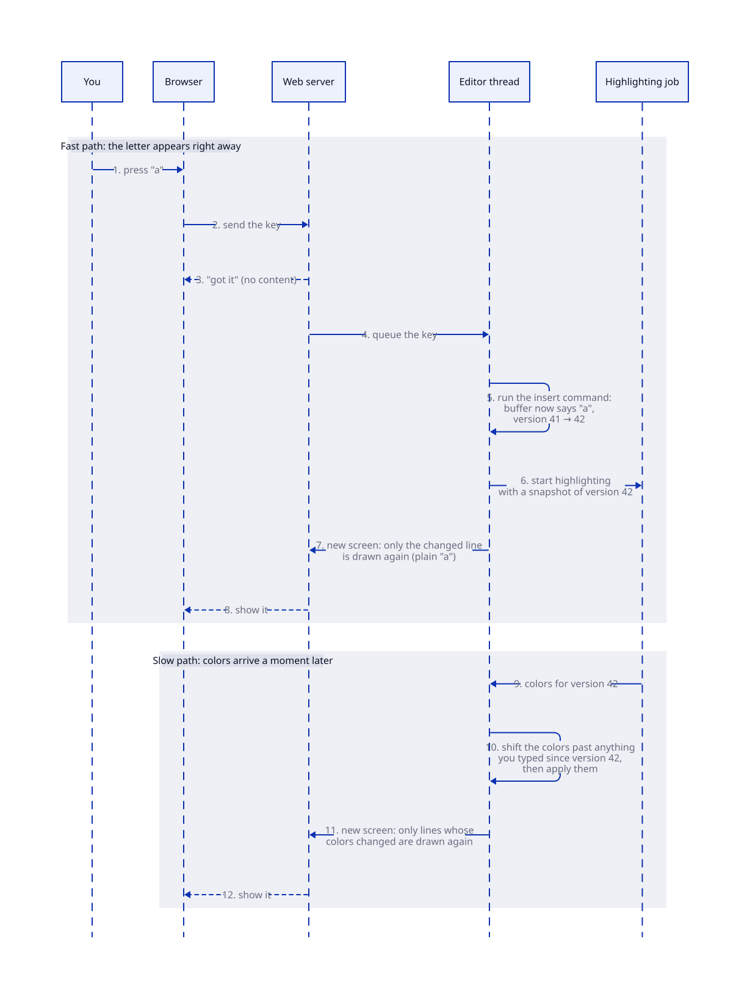

The important part is the split between the fast path and the slow path. The letter shows up after one command and one redraw (steps 1–8). Highlighting runs separately and arrives a moment later (steps 9–12).

The redraws in steps 7 and 11 rebuild only the line that changed: every other line, view and part of the screen is reused as it was ([drawing only what changed](#drawing-only-what-changed)).

Every change bumps the buffer's version number. The highlighting job works on version 42. If you've typed more by the time its colors come back, Tuna keeps a short record of every change since version 42 and shifts the colors past what you typed, so they still land on the right characters. In Emacs, slow work like this freezes the whole editor. In Tuna it can't, because it never runs on the editor thread.

And if a command itself gets stuck, say in an endless loop, pressing `C-g` stops it. Tuna watches for `C-g` the moment it arrives, instead of waiting in line behind the stuck command. It first asks the command to stop, which well-behaved code notices right away; if the command doesn't respond quickly, or you press `C-g` again, Tuna stops it forcibly. Emacs can only stop code that remembers to check for `C-g`.

## How a command can ask you a question

**Status:** built.

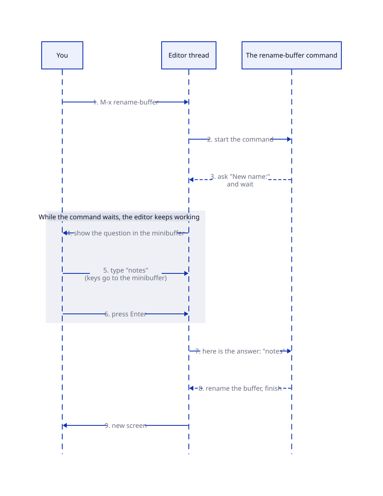

A command can stop in the middle and wait for an answer, just like in Emacs. While it waits, the editor keeps handling your keys and sends them to the minibuffer. When you press Enter, the command continues where it left off. For the person writing the command, it reads top to bottom:

```scheme
(defcommand (rename-buffer)
  "Give the current buffer a new name."
  (let (name (read-string "New name: "))   ; waits here; the editor keeps running
    (set-buffer-name! (current-buffer) name)))
```

Names in code samples are illustrative; the exact API will be settled when it's built.

Answers are remembered per question kind: `M-p` and `M-n` step through earlier answers, and the lists survive restarts.

## Choosing from a list: completion

**Status:** built (`M-x`, the file picker, `recent-file`); other pickers will reuse it.


When a command asks you to choose (a command, later a file or a buffer), it calls `completing-read` with a list of **candidates**. A candidate is a small record, the text you see and the value you get back, not a string with hidden data as in Emacs. Two plugins share the work, the way Vertico, Orderless and Marginalia do in Emacs, but without advice. The **completion** plugin (`completion`) holds:

- the **engine**, which keeps the running question (the **session**: what you typed, the matches, the selection), sorts recent answers first, and updates the list in the same redraw as your keystroke;
- the **matching styles**, which decide what matches: in the starter, `any-order`, the parts you type, separated by spaces, in any order (`view sel` finds `select-view-left`), each as plain text or a regular expression, with upper case mattering only if you type it, then `substring`; other plugins can add styles;
- **annotations**, details beside each candidate of a **category**: for commands, the key binding and the first line of the description; other plugins can add annotators;
- `M-x`, which asks the engine to choose a command and runs it;
- **sources**: one question can offer several groups of candidates in one list, each from its own table with its own category, annotations and title. The file picker offers "Recent files", then "This folder"; what you type is matched against all of them (a source may match only part of it), and each group keeps its own order. Consult's sources in Emacs are the model.

The **completion list** plugin (`completion-list`) shows ten rows below the prompt, with a heading wherever the group changes: `C-n`/`C-p` move, `RET` chooses, `TAB` copies the selected text into the prompt, `M-RET` takes exactly what you typed, and a click chooses a row. Turn it off, and `M-x` keeps working with less. Commands have their own contract (listing them, their descriptions, running one by name), and `pre-command-hook` and `post-command-hook` run around every command.

## Changing package code while Tuna runs

**Status:** open functions, explicit redefinition, function and command advice, and `describe-advice` are built (2026-10-16). Advice on service operations comes with the profiler; `C-M-x` comes with the REPL milestone.

In a module using `#lang :tuna/prelude`, a top-level procedure `def` or `def*` makes an **open function**: calls always reach its current implementation, even from already-compiled code or a reference saved earlier. `redefine` replaces that implementation. A private function can be changed by evaluating inside its module, the supported mechanism behind Gerbil's `enter!`; this does not reload the module or duplicate its state. Exports still decide which names a normal import brings into scope.

Only Tuna-prelude modules change this way. Imported Gerbil libraries and Tuna's kernel stay ordinary. `def/closed` keeps normal Gerbil optimization for a measured hot spot. Values, local definitions, methods and structs are unchanged. There is a small measured cost: about one extra microsecond per typed character in the stage-1 comparison, plus longer builds and configuration evaluation. The [language decision](../agents/adr/0001-language-and-extension-surface.md) records the limits and evidence.

`advise!` can wrap an imported open function, or a private one named by module and function. Advice has an owner and name, can run before/after/around a call or change its arguments/results, and is removed when its owner turns off. `redefine` replaces the underlying definition without discarding its advice. Changes are combined when registrations change, not on every call; configuration reload also refreshes their order. Source redefinition and function advice affect the shared package function, not just the editor context that installed them. Ownership determines cleanup. Owned around-advice measured about 0.7 microseconds per scalar call; the unadvised entry stays unchanged.

Commands can be advised too: `(advise! ctx (command-target 'delete-backward-char) 'hungry around: …)`. The commands plugin keeps the advice under the command's name, so it applies to whichever plugin defines the command and survives that plugin turning off and on. The `hungry-delete` demo plugin (`demo/hungry-delete.ss`) does exactly this. `M-x describe-advice` lists everything currently advised, outermost layer first, with owners and sources.

## Plugins: how things get added and removed


When a plugin is turned on, everything it adds goes through its **receipt**: a running list of what it added and how to undo each item. Turning the plugin off walks the receipt backwards and removes everything. Each key binding or setting a plugin makes is labeled with that plugin, so turning one plugin off never erases a binding another plugin made for the same key. Reloading a plugin is just "save its state, off, load the new code, on, restore its state". That means you can fix a plugin and reload it without restarting, and you never end up with leftover keys or hooks from an old version. Emacs has no equivalent; its `unload-feature` is best-effort.

A plugin file looks like ordinary Emacs-style code. Everything at the top level belongs to that file's plugin:

```scheme
#lang :tuna

(defcommand (forward-char (count 1))
  "Move the cursor COUNT characters forward."
  (goto-char (+ (point) count)))

(keymap-set global-map "C-f" forward-char)

(add-hook after-save-hook 'announce
  (lambda () (message "Saved")))
```

Your own configuration file, `init.ss`, declares which plugins to turn on, and the rest of its code becomes one more plugin, turned on last (built, including reload):

```scheme
#lang :tuna/config
(import :tuna/plugins/keys/plugin :tuna/plugins/web/plugin :tuna/plugins/configuration/plugin
        :tuna/plugins/keys/contract        ; keymap-set
        :tuna/plugins/commands/contract)   ; defcommand
(use-plugin keys)
(use-plugin web-transport port: 8080)
(use-plugin configuration config: (keymap-set "C-c R" 'reload-config))
(defcommand (say-hello) "Say hello." (message "hello"))
```

Tuna looks for it at `tuna --config PATH`, then `$TUNA_CONFIG`, then `~/.config/tuna/init.ss`. Without one it turns none of your plugins on and says how to get one: `tuna init` copies the starter configuration (`starter/init.ss` in the repository) there. Loading the file runs only its imports and its `use-plugin` declarations, which change nothing; Tuna then turns the declared plugins on one by one, and a plugin that fails is turned off again while the rest come up. Two things do run while the file loads and must not change the editor, because nothing could undo it: the code of the modules it imports (plugin modules only define plugins, so they are safe) and macro code. Definitions in `init.ss` belong to your own plugin, so `config:` blocks cannot see them; helpers both need go in a module that `init.ss` imports by a path such as `(import "my-helpers")`, found next to `init.ss`. Each plugin, and your own code, gets 5 seconds to turn on; one that takes longer is stopped and turned off. What came up, what failed, and what was skipped is printed when Tuna starts and written to `~/.local/state/tuna/startup.log`. Start-up always turns on one plugin of its own, `session-owner`, even without a configuration: it provides the configuration contract (`tuna/configuration.ss`), which lets plugins reach reload, swapping a plugin, the last report, and evaluating code into the running session, and adds no editor feature; nothing else is turned on without a configuration. When something went wrong (anything failed, was skipped, turned off, or deferred) and a plugin can show messages, the echo area also says so in one line naming the log file and, when it exists, the `show-config-report` command (the starter binds it to `C-c C-r`), which shows the whole report of the last start or reload again.

`use-plugin` can give a plugin options, as `port: 8080` above. Each plugin declares the options it accepts, with a type, a default, and documentation; option values are written as data and never run. Loading `init.ss` checks every option, and every declaration (a plugin declared twice, a name that is not a plugin, a reserved name), before anything changes and reports every problem with its line, for example `init.ss line 6: modal option leader must be a string`; options go before `config:`; a file with any problem changes nothing, and `tuna check` reports the same problems from a terminal. The plugin reads its options when it is turned on; changing an option's value in `init.ss` and reloading replaces that plugin (and restarts its `config:` block with it), and turns the running version back on if the new one fails; reordering options or writing out a default changes nothing. A plugin can also give an option a command-line flag; the web transport's `port` option is the first: `tuna --port N` overrides it, and the start-up report says so. `tuna --help` lists the flags of the plugins your configuration declares. Plugins write to the terminal through Gerbil's logger; the web transport prints the link to open, and Tuna's program decides how log lines look.

After editing `init.ss`, reload it without restarting: run the configuration plugin's `reload-config` command (the starter binds it to `C-c R`), or `tuna reload` in a terminal, which works even when your input plugins are broken and prints the result there. `tuna reload` asks every Tuna you are running with the same `$XDG_RUNTIME_DIR`, including test or development ones, and waits at most 30 seconds for each. Reloading loads the file again as a trial; if it does not load, nothing changes and you see the error and its line. Otherwise Tuna compares it with what is running and changes only the difference: plugins no longer declared are turned off, new ones turned on, and a plugin, `config:` block, or your own code that changed is replaced. If the new version fails, it is undone and the version that was running is turned back on. That guarantee covers `init.ss` itself, its `config:` blocks, your own code, and plugins from Tuna's or installed packages' compiled modules. A module of your own that `init.ss` imports by a path is the exception: when its file changed, it is loaded again in place, so its new definitions replace the running version's as soon as it loads, even if the reload then fails, and a running version that is turned back on calls the new definitions. A restart starts clean. A plugin that a reload turns on gets its saved session data, and replacing a plugin goes through the swap described [below](#swapping-out-a-part), so its new version, or a different plugin filling the same slot, starts from its latest saved data. A plugin that changes how keys or the display work (a startup-tier service) changes at the next start. The reload report, in the start-up report's format, goes to the echo area or the terminal that asked; it is not written to disk.

## Swapping out a part


Some parts of Tuna are **services**: a named slot plus a promise of what fills it. For example, the "text store" slot promises operations like *insert*, *delete*, and *read a line*. Buffers only ever talk to the slot, so any implementation that keeps the promise can fill it. Tuna ships a rope (a tree of text chunks that makes copies of old versions free, which background jobs rely on), but a plugin can fill the slot with something else:

```scheme
(defplugin (gap-buffer-plugin ctx)
  "Stores text in a gap buffer."
  provides: [text-store-service]
  (context-provide! ctx text-store-service (make-gap-buffer-store)))
```

The renderer is a service too, which is how a terminal version of Tuna could exist later.

**Status:** built (2026-10-14). The tabs layout in the diagram is an example; the demo swaps between the default layout and a toy two-view layout.

Each service has exactly one plugin filling it. A plugin says which services it fills (`provides:`), which it needs (`requires:`), and which it uses only when present (`optional:`). When loading a configuration, Tuna checks the plugin's imports, including its own package's private modules: importing a contract that exports a service means declaring that service. A missing declaration refuses that plugin before it starts and names the plugin, contract, and service; other plugins still start. Service calls themselves are plain lookups, with no caller tracking. Your own code in `init.ss`, in `config:` blocks, and code you evaluate is exempt, as Emacs puts no rules on `init.el`; activating a package plugin from evaluated code still checks that plugin. Declaring two plugins for one slot is an error that names both.

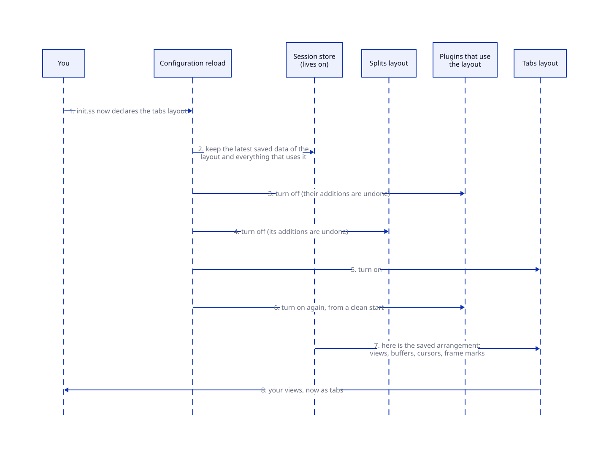

Swapping the plugin in a slot, by editing `init.ss` and reloading or with a command such as the demo's `C-c w`, follows the numbers: Tuna keeps the latest saved data of the plugin and of everything that uses it, turns them all off (undoing everything they added), turns the new plugin and the users back on from a clean start, and gives each its saved data back. A plugin restores its own saved data when it has some; otherwise it restores the contract's shared form, which is how a tabs layout can pick up the views a splits layout saved. Your text, cursor positions, views and frame marks come back; in-memory state such as undo history does not. If anything fails, the old plugins come back.

Code you evaluate into the running session (later with `eval-buffer` or `M-:`, as in Emacs) belongs to one always-on owner, the session owner. A key it binds stays bound across `reload-config`, evaluating the same code again changes nothing, and changing `C-c x` to `C-c y` adds the new key while the old one stays, exactly as in Emacs.

## Buffers are trees

In Emacs a buffer is always a flat piece of text with decorations. In Tuna a buffer holds a small tree of **nodes**, like HTML. A file you're editing is a buffer with a single text node, so it behaves just like Emacs. A richer screen, such as project-wide search results or a Git status view, can use columns, lists, and collapsible sections, with text nodes inside them that you still navigate with ordinary editing keys. Monospace and proportional text can sit in the same buffer; the browser does the layout. Rich buffers come later; plain text comes first.

Positions in a buffer count characters from 1, as in Emacs, because they are something people read.

A buffer is a generic piece of UI, not just a file: the minibuffer, the echo area, `*Help*`, and a sidebar of buttons are all buffers. Saving to a file will belong to the buffer's text, not to the buffer.


A **view** is one place on screen showing a buffer. Two views can show the same file, each with its own cursor and scroll position, while sharing the buffer and its text. A view is what Emacs calls a window; Tuna has no separate window. A view can also hold several cursors, which is how multiple-cursor editing will work later.

## What's on screen: the layout

**Status:** built, except scrolling strips.


The screen is one tree. The **layout** arranges views in **containers**: *fit* containers split their space (by shares, or as big as the content), *tabbed* containers show one child at a time with a tab strip, and each is horizontal or vertical. Each container remembers which child you were last in. The layout plugin owns the layout as a frozen value: every change makes a new tree that shares the unchanged parts. Buffers plugins own buffers, changed in place, and every change stamps the changed part and the parts above it with a new revision number. To draw, the renderer walks the layout and, inside each view, that view's buffer. Every redraw sends the whole visible screen, but a part whose revision, view state, and display settings have not changed reuses the HTML it made last time.

The **frame** is where you're looking: a pointer to any part of the tree, which the browser tab draws. `C-x n i` and `C-x n o` zoom in and out one level, `C-x n s` puts the frame on the node at point, `C-x n w` goes back to the top, and `C-x 1` puts it on the selected view (unlike Emacs, nothing is deleted). Zooming never changes the tree, only what you see. **Frame marks** save frame locations (`C-x r w`, `C-x r j`, `C-x r l`); they point at parts, not paths, so they survive rearranging.

Zooming hides the parts outside the frame, except **pinned** ones. A pin is a flag on a part; it never moves anything. At each container between the frame and the top of the tree, the container shows the part you're zoomed into plus its pinned children, in their usual places, and the zoomed part gets the space the pinned ones don't use:

```text
root (top to bottom)                       zoomed onto main.ss:
├─ main (left to right)                    ┌──────────┬──────────────┐
│   ├─ explorer          [pinned]          │ explorer │ main.ss      │
│   ├─ editors (tabs): main.ss, notes.txt  ├──────────┴──────────────┤
│   └─ outline                             │ terminal                │
├─ terminal              [pinned]          ├─────────────────────────┤
└─ bar          [pinned, locked]           │ minibuffer, echo area   │
                                           └─────────────────────────┘
```

The minibuffer and echo area are ordinary buffers in views in that locked, pinned bar, put there by their plugins; a locked part can't be unpinned or deleted by you. A question appears in the minibuffer nearest the view you're in, so a pinned minibuffer inside one split serves just that split. Splits are `C-x 2` and `C-x 3`, `C-x 0` deletes a view, Shift-arrows move between visible views, and tabs use Emacs's `C-x t` keys. `C-x w p` and `C-x w u` pin and unpin the selected part, `C-x w a` and `C-x w c` widen the selection to the surrounding container and back, and `C-x w` followed by an arrow moves a part past its siblings or into a neighboring container. The layout, frame, marks and pins are saved with your session.

## Several tabs

**Status:** built 2026-10-22 ([ADR 16](../agents/adr/0016-several-tabs-mirror-one-editor.md), brief [several tabs](briefs/2026-10-several-tabs.md)).

You can open Tuna in several tabs or on several devices at once. Every tab mirrors the same editor, like attaching to one tmux session: the same layout, the same views at the same place, each laid out by its own browser. Everything is shared editor state on the server, except three things kept per tab, also on the server, never saved, and forgotten a minute after the tab's stream closes: its id and connection (input numbering, which screen it was sent), its keys in progress (a half-typed `C-x`, the last command), and what its browser measured. Each redisplay draws one screen per tab from shared state plus that tab's measurements. The tab you use drives the scroll position: when its scrolling comes to rest, every other tab gets one placement to the same item, so a fling moves the others once, where it ends; a report that only confirms a placement moves nothing, so tabs of different sizes never bounce each other. Commands that move a view (`C-v`, `C-l`, point leaving the view) place every tab. `C-g` stops a running command from any tab.

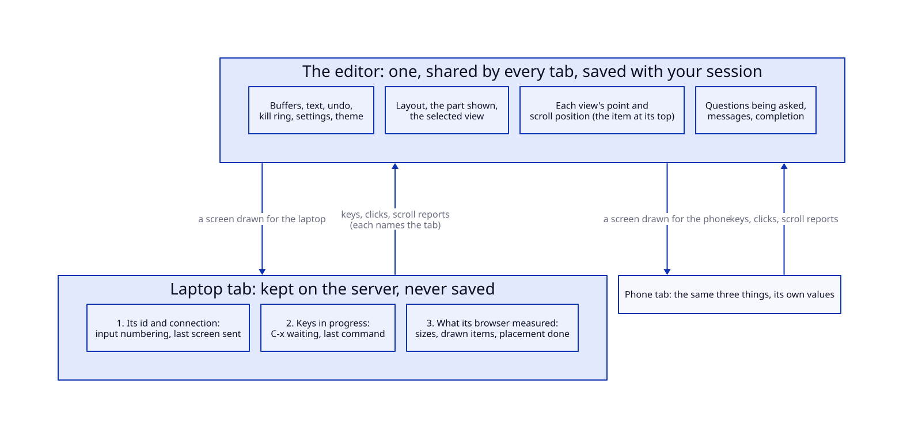

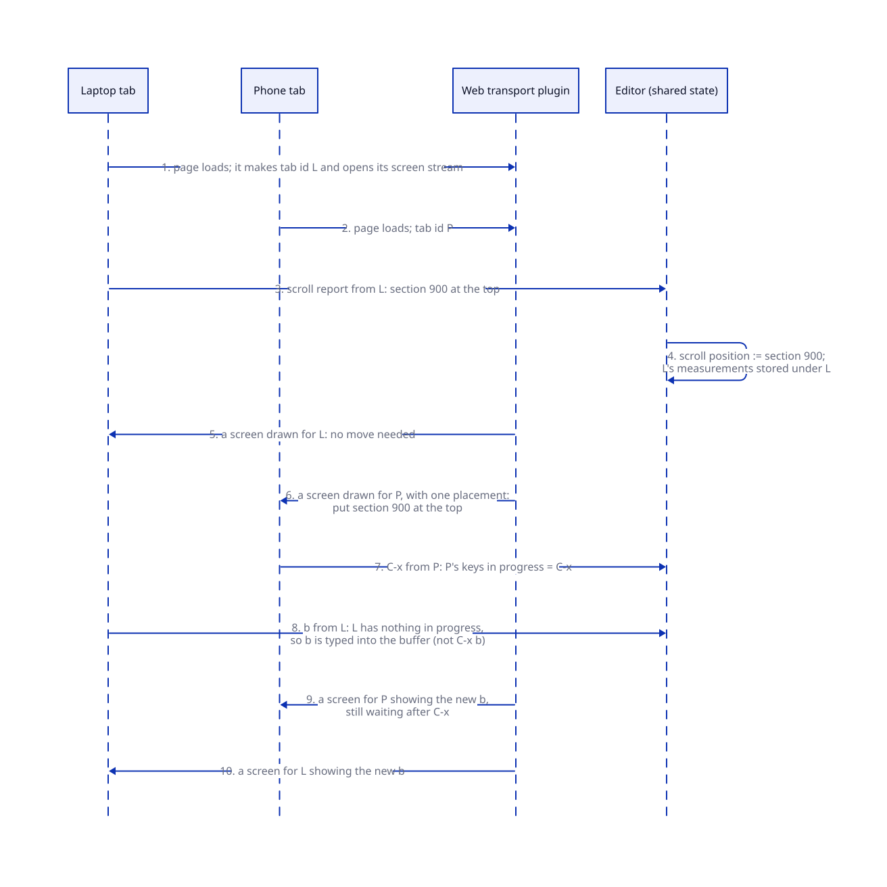

## Scrolling

**Status:** built for views (2026-10-17, [ADR 15](../agents/adr/0015-scroll-state.md); the browser's own scroll bar since 2026-10-21). Node scrollers and scrolling strips use the same model and come with their first user.

A buffer can be enormous, so a view draws only what is near what you are looking at: about two view heights above and below (the `drawn-screens` setting). The browser scrolls natively, so wheel, trackpad, finger and momentum feel the way they do on any page, and the scroll bar is the browser's own.

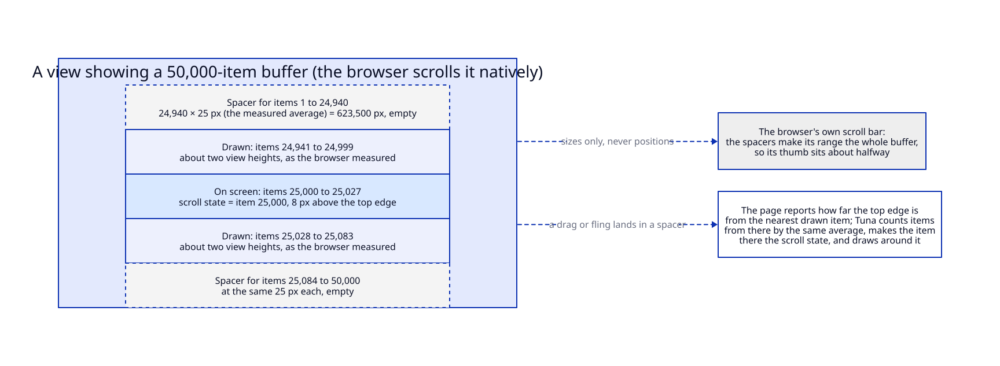

A view lays out **items**: a text's lines, a list's rows; each kind of node says what its items are, and the scrolling code never knows which. The view's **scroll state** is the item at its top edge and how many pixels of it are above the edge, as the browser measured; it is shared by every tab, while what each browser measured is kept per tab. Above and below the drawn items, a **spacer** stands in for the rest, as high as those items would be at the average item height the browser measured for this view. That average is the only estimate in Tuna, and it only sizes spacers, so the scroll bar covers the whole buffer; every position still comes from the browser. The view's total height is fixed at all its items times that average, measured once when the view first shows its buffer, and the browser fits the spacer below to whatever the drawn items leave; so the total stays the same while you scroll, which Chrome on macOS needs for the scroll bar's thumb to follow your pointer. When a drag of the scroll bar or a fast fling lands in a spacer, the page says how far it is from the nearest drawn item, and Tuna counts items from there by the same average, makes that item the scroll state, and draws around it.

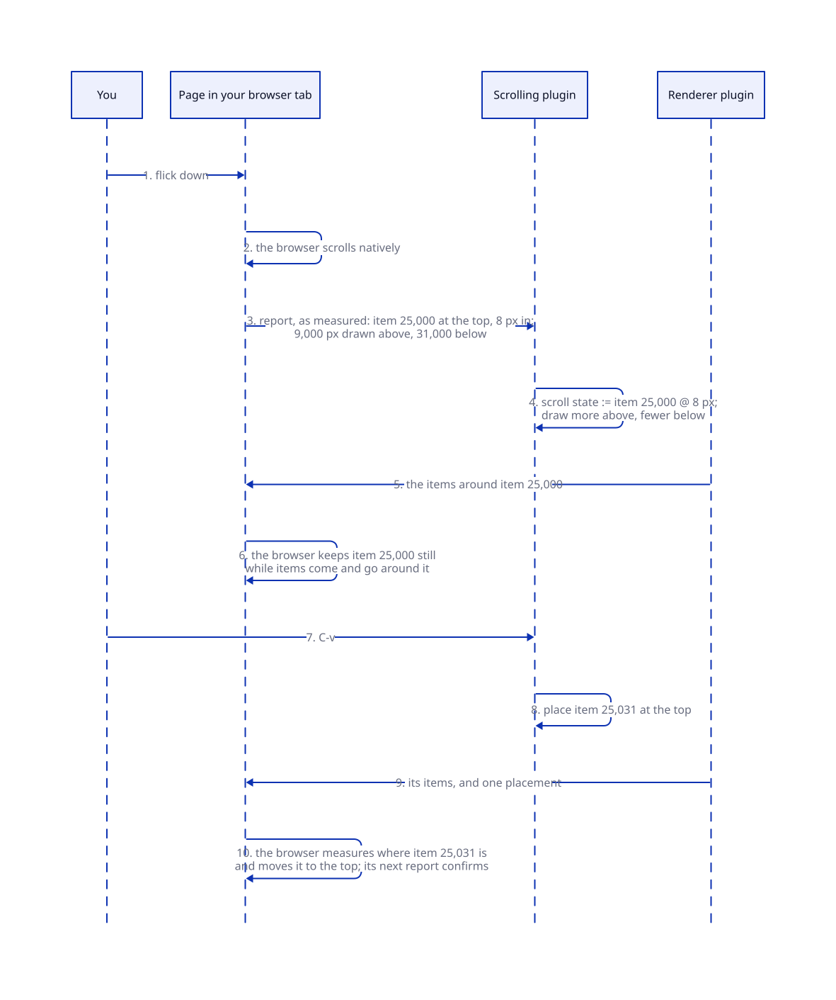

There are two flows. When you scroll, the browser reports what it measured (only when you near the end of what is drawn, or a spacer comes into view, one report at a time), and Tuna draws more ahead and drops what is far behind; the browser keeps the item you are reading still. When Tuna moves the view (`C-v`, `M-v`, `C-l`, `M-<`, `M->`, point moving off screen, a refresh, a restart), it **places** an item at the top, centre or bottom, and the browser carries that out once. Scroll reports are special events, like Emacs's focus events: they never count as a command. Whichever moved last wins: after you move point, the view follows it; after you scroll, point follows into view (the `scroll-moves-point` setting turns that off). Each view's scroll state is saved with your session, and a refresh keeps your place.

## Drawing only what changed

**Status:** built 2026-10-22 ([ADR 17](../agents/adr/0017-memo-and-sources.md); brief [drawing only what changed](briefs/2026-10-drawing-only-what-changed.md)).

Every redraw still sends the whole visible screen to the browser as one piece of HTML, as before. What changed is how cheaply Tuna produces it. The screen is made of **pieces**: the screen, each view, each node of a buffer, each line of a text, each row of a list. Each piece is drawn through one function, `memo`, which notes everything the piece read while drawing: a node's attributes, a line's text, the highlighting and cursor on a line, a setting, what this tab measured. Everything that can change has a **revision** that moves when it changes. On the next redraw, a piece none of whose reads moved is reused as it was, and a parent with nothing changed beneath it is reused in one check. Renderers are ordinary functions that never mention any of this; the accessors they read through do the noting.

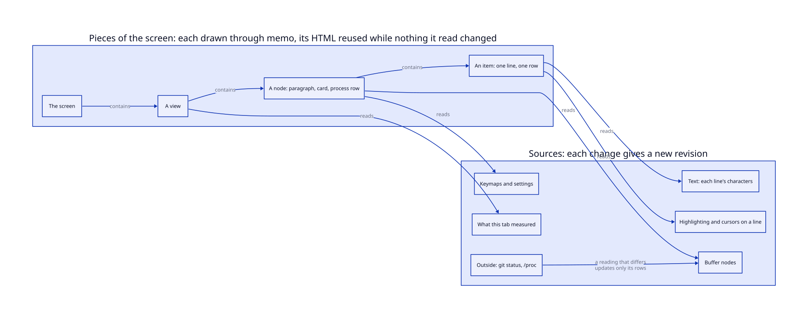

Lines are compared by what they show (their text, the highlighting on them, the cursor on them), not by their position, so this works for any way of storing text. Typing a letter redraws one line; moving the cursor redraws the one or two lines it left and entered; a highlighting result redraws only the lines whose colours changed, and an identical result redraws nothing. Pieces that did not depend on a particular tab are shared by every tab. Pieces are kept as bytes, and the screen is written straight into the stream, so producing a screen copies nothing that did not change. When nothing changed, nothing is drawn or sent: an idle editor does no work at all. In tests, every screen is drawn twice, once reusing pieces and once from scratch, and the test fails if the two differ, which catches a renderer that reads something behind Tuna's back.

## Work off the editor thread

**Status:** built 2026-10-23 (brief [work off the editor thread](briefs/2026-10-background-work.md); [ADR 3](../agents/adr/0003-command-loop-and-jobs.md)).

Only the editor thread changes editor state, so nothing needs a lock. Slow work runs elsewhere on plain data (numbers, strings, lists, snapshots of text) and its result comes back to the editor thread, which applies it; the screen then redraws what changed. A command that needs slow work calls `(off-thread procedure input)`: the command pauses, the work runs on another thread, and the command carries on with the answer, while you keep typing. `(sleep-for seconds)` pauses the same way. `C-g` stops a command that is waiting, from any tab.

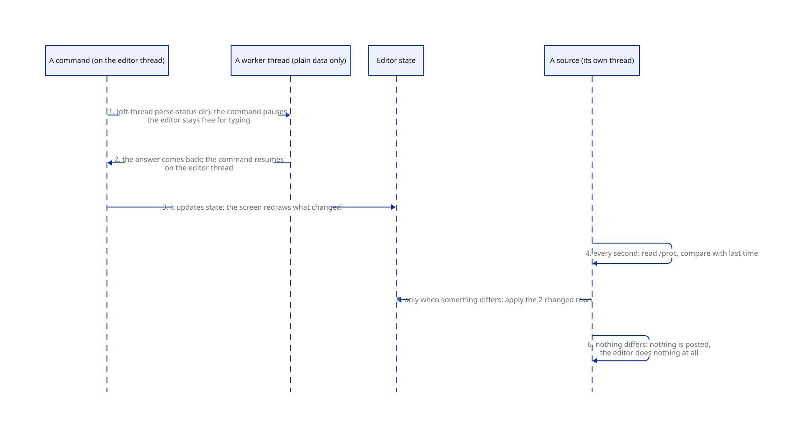

State that lives outside Tuna, such as running processes, git status or files, comes in through a **source**: something read on its own thread every so often, compared there with the last reading, and posted to the editor only when it differs. So a source that sees nothing new makes the editor do nothing. The demo's `C-c P` opens `*Processes*`, a live process list fed by a source reading `/proc` every second: when two processes change, two rows are redrawn.

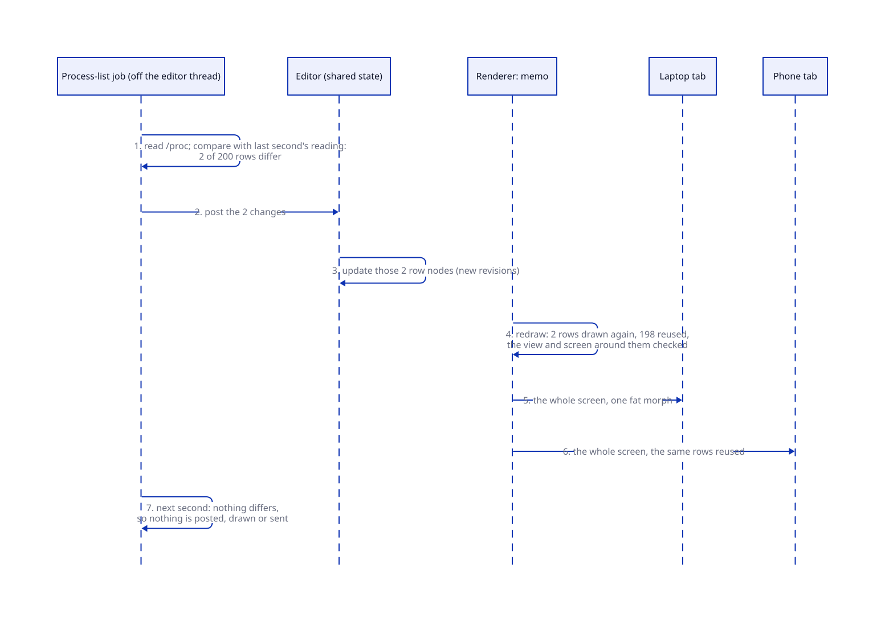

## Profiling

**Status:** built 2026-10-27 (stages 1 to 3 of [the profiler plan](../agents/plans/profiler.md); brief [a profiler outside the core](briefs/2026-10-profiler.md)). Advice on service operations is not built: it is an open question in `TODO.md`.

The profiler answers "where did the time go?" for every key press, click, scroll report and paste, from the browser's key event to the browser having painted the resulting screen. It is two optional plugins (the demo declares both); nothing else in Tuna knows them.


The parts it watches only announce what happens, through general hooks any plugin can use: the browser connection says when an input item arrived, when a tab's screen is ready, written and applied; the key handling says when it takes an item from the queue; the editor thread says when a task starts and finishes; commands have their pre- and post-command hooks; the jobs library says when a job starts and finishes; the renderer says when it starts and finishes drawing a screen, with how many pieces it drew again and reused. The browser page measures its own durations (from the key event to sending it, applying the screen, and the paint after it) and sends them with the confirmation it already posts for every screen. Each screen also says which of its tab's keys it includes, so a paint can be matched to its keys. Times from the browser and from Tuna are never compared as clocks: the network's share is the browser's round trip minus Tuna's own time.

**Span trees.** With `profiler` on, each input item gets a tree of timed spans: waiting in the queue, the task and its command with its hooks and the jobs it started, then one branch per tab: the redraw, waiting for the tab to apply its previous screen, writing the screen, and the network and the browser's morph and paint. Each span records its start, duration, the bytes allocated and the garbage-collection time while it was open. When every tab has painted, the tree is written as one line of JSON to `spans-<time>.jsonl` in `$XDG_STATE_HOME/tuna/profile/` and forgotten, so nothing piles up in memory. Every item is written by default; options choose the folder, a file size after which a new file starts, and a minimum duration below which items are skipped. `M-x profiler-mode` turns it off and on again; off, no hook has a profiler callback.

**Sampling.** `M-x profiler-start` samples the call stack of whatever thread is running every millisecond, as Gerbil's `gxprof` does, and `M-x profiler-stop` writes them to `samples-<time>.folded`, one `stack;of;frames count` line per distinct stack, each starting with the input item it was taken during. This finds slow code no span names, Tuna's own core included. It relies on Gambit internals, and a test fails loudly if they change.

## Selecting text and the clipboard

**Status:** built 2026-10-23 (brief [clicking and selecting text](briefs/2026-10-selecting-text.md)).

Selecting works as in Emacs. The **mark** is the other end of the selection from the cursor, and the text between them is the **region**. `C-SPC` sets the mark, `C-x C-x` swaps the two ends, `C-g` or an edit ends the selection, and Shift with a movement key selects as you move. Each view keeps its own cursor and mark, so two views of one buffer can select different text. With the `delete-selection` setting on (it is off by default), typing replaces the selection, as in most editors.

The **kill ring** is Tuna's list of recently cut and copied text: `C-w` cuts, `M-w` copies, `C-y` pastes the latest and `M-y` steps back through older ones.

Words work as in Emacs: `M-f` and `M-b` (or Ctrl or Alt with the arrow keys) move over them, `M-d` and `M-DEL` (or Ctrl with Delete or Backspace) cut them, `M-@` selects them, `M-t` swaps two, and `M-u`, `M-l` and `M-c` change their case. Cutting several words in a row makes one entry on the kill ring, so `C-y` brings them all back. They work in the minibuffer too, so `M-DEL` in the file picker deletes the last folder name. Until modes exist, a word is a run of letters and digits in any script, plus `$` and `%`.

The mouse works on text too. The browser only finds out which line and column you pointed at; the server does everything else, as with keys. A click moves the cursor there, in any text of the buffer. Pressing and dragging selects, with each step drawn by the server, one at a time; double-click selects a word, triple-click a line, and shift-click extends the selection. A click made on a screen that has since changed still lands on the character you clicked, because Tuna replays the edits made in between.

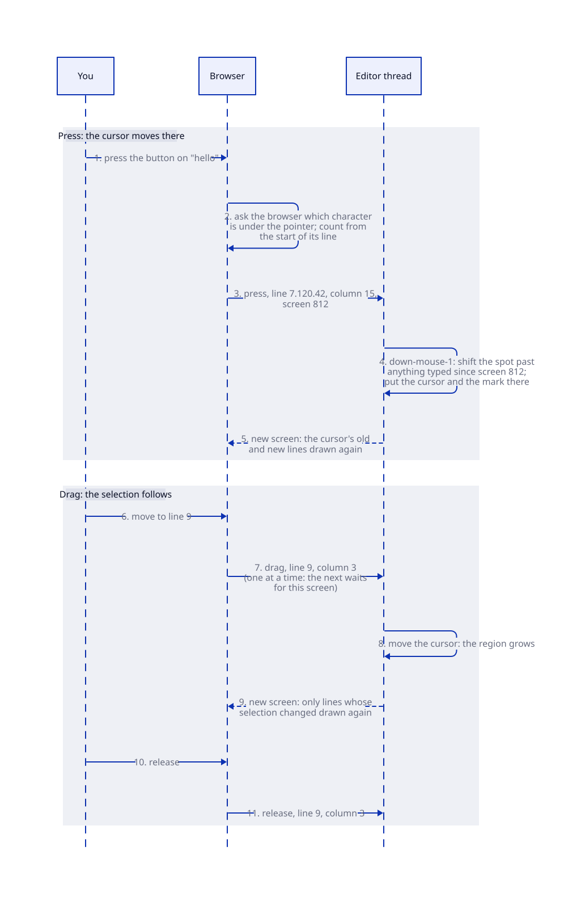

Copying also reaches your computer's clipboard, through the tab where you pressed the key. Browsers allow that only on HTTPS or `localhost`; elsewhere the text stays on the kill ring and the echo area says why. The browser's own paste key (Cmd+V on a Mac, Ctrl+Shift+V or Shift+Insert elsewhere) pastes from the clipboard, and `C-v` still scrolls.

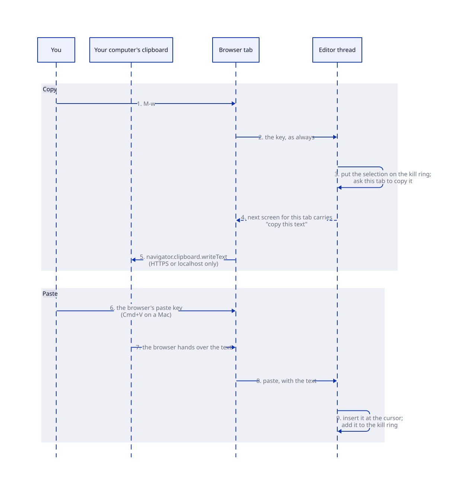

## Voice dictation

**Status:** built 2026-10-24 (brief [voice dictation](briefs/2026-10-voice-dictation.md)). In the demo configuration; the starter leaves it out, since it needs the speech worker and a model on this machine.

Press `C-c v` and talk: the words appear at the cursor a fraction of a second after you say them. `C-c v` again, or `C-g`, stops. The words go wherever the cursor is when they arrive, exactly as if you typed them, so you can type, press Return or move the cursor between sentences and the next words follow it. The speech model sends a sentence's full stop or comma with the next words, so that punctuation goes after the words you said before, not at the cursor, as long as they are still there. Undo removes what you said between pauses, one stretch at a time; anything you typed in between is its own undo step.

The microphone is the browser's, so the tab records and sends the audio, and the server says when to start and stop. Recognizing speech would freeze Tuna, so a separate program, the **speech worker**, does it (`make voice-worker` builds it against the local `gerbil-parakeet`; the default model is nemotron). The audio goes from the tab straight to the worker, never through the editor thread; only the recognized words become editor work.

Three plugins share the job, and the web plugin knows nothing about microphones. The **web plugin** offers general **page machinery** any plugin can use: put the plugin's own script on the page, receive what that script posts at the plugin's own address, and send one tab a one-time instruction after its next screen. The **microphone plugin** uses it to capture a tab's microphone at 16 kHz. The **voice plugin** uses the microphone, runs the worker, and inserts the words.

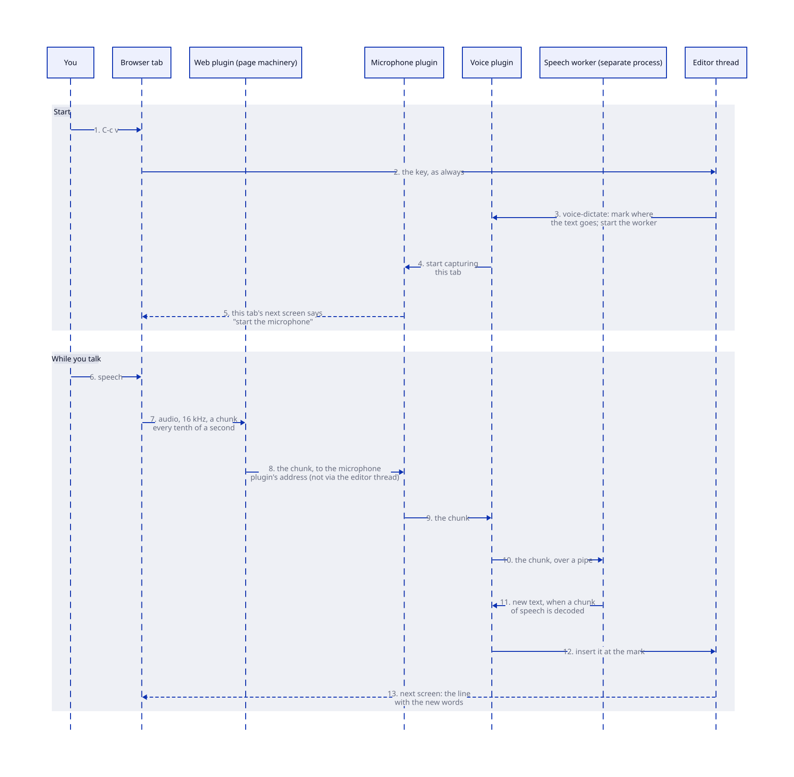

The browser gives a page the microphone only on HTTPS or `localhost`; elsewhere, or when you refuse it, the echo area says why.

## Spoken commands

**Status:** built 2026-10-24 (brief [spoken commands](briefs/2026-10-voice-commands.md)). In the demo configuration, on `C-c c`.

Press `C-c c` and say a command's name, "split view right": Tuna runs `split-view-right`. Every visible command can be said, including ones a plugin adds later, because the list is made fresh each time from the commands that exist. A command's spoken name is its name with hyphens as spaces; a command whose name has digits or other symbols can't be said, unless you give it a spoken name in `voice-command-names`.

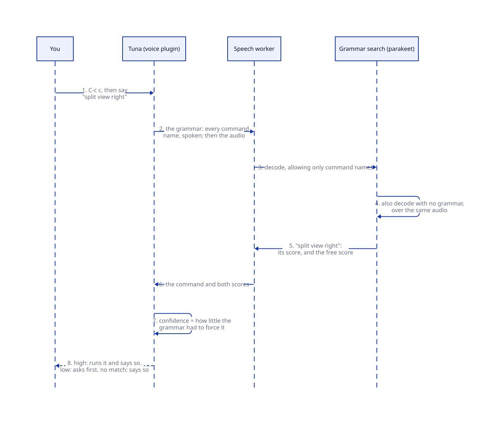

*Built as drawn.*

The speech worker listens with a **grammar**, the list of every spoken name, so what it hears can only come out as a real command; it uses a fast English model (`realtime_eou`) that also notices when you stop talking. The echo area says "Say a command…", then what it has heard so far. You never press a key to finish. Listening ends by itself:

- when the model reports the end of what you said;
- when nothing new is heard for `voice-command-end-pause` seconds after you started speaking;
- as soon as what you have said can only become one name ("split view r…"): at once if it already is the whole name, otherwise after `voice-command-unique-grace` seconds for the rest of the name (`voice-command-finish-when-unique`);
- after `voice-command-start-timeout` seconds if you say nothing: "No command heard".

`C-g` while listening cancels. A grammar forces any speech into the nearest name, so Tuna also computes a **confidence**, from 0 to 1: how little the grammar had to force the result, comparing its score with the score of the best transcription without the grammar over the same audio. Then:

- **Clear** (at least `voice-command-run-confidence`, and at least `voice-command-margin` ahead of the next best): it runs, and the echo area says "Ran split-view-right (voice, 0.99)".
- **Unclear:** the candidates at least `voice-command-offer-confidence` confident, at most `voice-command-candidates` of them, appear as the `M-x` list, best first and selected; `RET` runs it, `C-g` cancels. A command in `voice-command-always-ask` always asks.
- **Nothing:** "Didn't catch a command".

The defaults (run 0.85, margin 0.1, offer 0.4) come from recordings of command names made once with a speech synthesizer and kept with the tests; `make voice-command-check` runs them through the worker and shows what each setting would do. Most speech that is not a command, and noise, finds no name at all.

## How it looks: HTML and stylesheets

**Status:** built.


*Built as drawn. The dashed box is optional: your own file in `init.ss`.*

Every plugin draws its nodes as HTML and styles that HTML with its own CSS files, which it adds when it turns on and which go away when it turns off. Usually there are two:

- `tokens.css`, the plugin's **semantic tokens**: CSS custom properties that say what its parts mean, named after its classes, such as `--completion-selected-background`. Each is defined with a **design token** from the `stylesheets` plugin (Stellar's palettes, sizes and fonts) and a fallback, such as a system colour, so the page stays readable without design tokens.
- `rules.css`, which styles the plugin's HTML using only those names.

Follow the numbers in the picture: (1) completion's tokens use a design token; (2) its rules use its tokens; (3) your `init.ss` may replace its tokens file with your own; (4) the web transport links every stylesheet in the page's head, in `init.ss` order, so design tokens come first and your own files last.

Gerbil code holds no colours or styles. It knows only which files are on the page, who owns each, and their order. A stylesheet is named by its owner and a name, such as `(completion-list rules)`, so renaming a file breaks nothing. The renderer's classes and attributes (`.view`, `.buffer`, `.text`, `.line`, `.cursor`, `.status-line`, `data-clickable` and so on) are a published surface that other plugins may style; a rule that combines two plugins' HTML belongs to the plugin that adds the link, such as completion's rule for a minibuffer holding a completion list.

To restyle Tuna:

- **Change a few things:** add your own file in `init.ss` that redefines some tokens or rules: `(add-stylesheet 'mine "my.css")`. It comes after every plugin's, so it wins.
- **Rewrite a plugin's file:** `(replace-stylesheet 'layout 'rules "my-layout.css")`. Replacing with `#f` removes the file.
- **Use a theme:** a plugin that replaces other plugins' stylesheets. Turning it off restores what it replaced, and your `init.ss` beats any theme. The demo's `theme-terminal` (`C-c T`) is one: flat, monospace, reverse video.
- **Check:** `M-x describe-stylesheets` lists the page's stylesheets in order, and warns about a replacement for a file its plugin does not add and about any `var(--x)` without a fallback that nothing defines. After editing a file, `M-x reload-stylesheets` reads them again; the browser fetches only the files that changed.

Tuna ships its monospace font, Fira Code Nerd Font (Fira Code with the Nerd Font icons), which the page, code and terminals use: the `stylesheets` plugin's `(stylesheets fonts)` file puts it first in the `--font-mono` token. Replace that file to use another font.

The default look follows the system's light or dark setting, keeps the cursor visible in forced-colours (high contrast) mode, fills a phone's screen above its browser toolbar, and gives tabs, buttons, completion rows and clickable status lines finger-sized targets on touch screens.

## Files

`C-x C-f` opens a file, `C-x C-s` saves it, `C-x s` offers every unsaved file for saving, and `C-x C-w` saves under another name. The `files` plugin does all of it, remembers the files you opened and where the cursor was in each, and notices when another program changes an open file; turning it off takes these keys away.

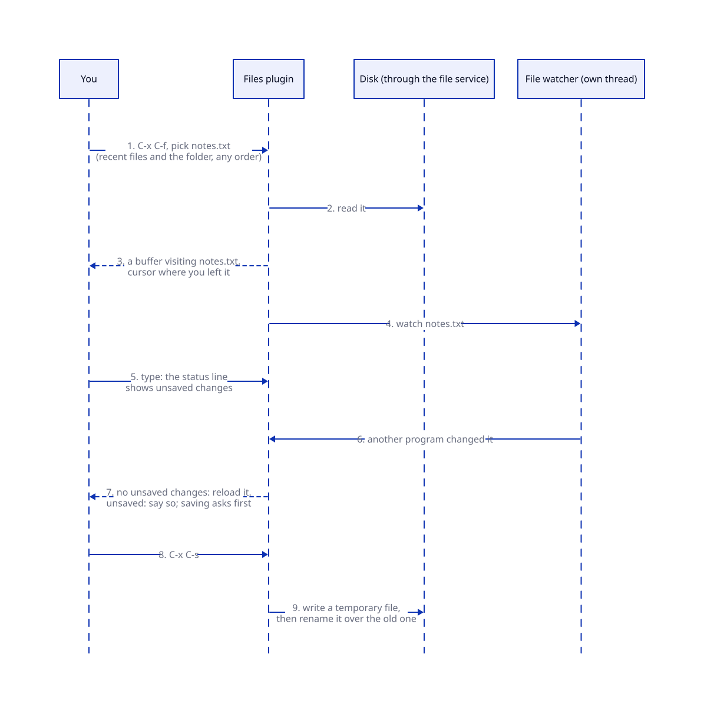

*Built (all four stages of the [files plan](../agents/plans/files.md)): every step, with recent files, the remembered cursor, changes on disk, and autosave of unsaved file buffers.*

A concrete case: in a folder holding `notes.txt`, you press `C-x C-f`. The **file picker** asks "Find file:" with the folder already typed, and lists the files you opened recently under "Recent files", then what is in the folder under "This folder", with each file's size and how long ago it changed; an open file says "open". You type `not` and `RET`; `notes.txt` is first because you opened it yesterday, and it opens with the cursor where you left it. The plugin reads the bytes through the **file service**, turns them into characters, and shows a buffer named `notes.txt`. You type; the status line shows `notes.txt *` (undo back to the saved text and it goes away). `C-x C-s` writes a temporary file beside it, flushes it to disk, gives it the old file's permissions and owner, renames it over the old file and flushes the folder, so a crash leaves the old file or the new one, never half of each. The `*` goes away.

What to know:

- **The text visits the file, not the buffer.** The visit record on the text says which file, what was on disk at the last read or save (with a hash of its bytes, so later checks can tell Tuna's own writes from other programs'), and how its bytes became characters. A file reached through a symbolic link is the same text as the file itself.
- **Bytes are kept exactly.** UTF-8 with or without a byte-order mark is editable, and the mark is written back. Windows line endings on every line show as plain lines and are written back as Windows line endings; mixed endings stay in the text as they are. A missing final newline stays missing. Anything else (not valid UTF-8, UTF-16, binary) opens read-only with a note in the echo area, and saving it is refused. Tuna never guesses an encoding.
- **Saving through links.** A symbolic link saves into its target and stays a link. A file with other hard links, one whose owner a new file could not get, or one in a folder that takes no new files is written in place instead, after a backup copy that is removed once the new contents are on disk.
- **A new name makes a new file** on its first save; Tuna never creates a folder, and saving into a folder that does not exist says so.
- **`C-x C-s` in a buffer with no file** (`*scratch*`, say) asks "File to save in:" with the picker, saves there, and the buffer visits that file from then on, as in Emacs. A buffer you have not changed, or one that is not plain text (`*Processes*`, `*Help*`), says "(No changes need to be saved)".
- **The picker's keys:** `DEL` deletes one character, as in Emacs's file prompt (`M-DEL` deletes a word); typing `~/` after a `/` jumps home; `RET` on a folder opens the picker in it; `M-RET` takes exactly what you typed (for a new name that matches something).
- **Recent files** (Emacs's recentf): visiting a file, or saving under a new name, puts it first; a file is listed once by its true name, so a link and its target are one entry; at most `recent-files-limit` (100) are kept. The picker offers them while the folder typed is the one it opened at, matched against the name typed after it; type another folder and the picker lists only that folder. `recent-file` (through `M-x`) offers them alone. A file that no longer exists is dropped when the list is shown.
- **Remembered places** (Emacs's save-place): when a file buffer is killed or saved, and whenever the session is saved, the cursor's position is kept by the file's true name, for at most `remembered-places-limit` (400) files; opening the file again puts the cursor back (at the end, if the file got shorter). Both lists are session slots, so they survive restarts.
- **Two files with the same name** get their folder's name too: `notes.txt<docs>` and `notes.txt<work>`.
- **Killing an unsaved file buffer asks** (`C-x k`, in `view-commands`): "Buffer notes.txt modified; kill anyway? (yes or no)". Quitting Tuna does not ask yet: there is no quit command.
- **For package authors:** `before-save-hook` (a formatter, say), `context-add-save-takeover!` (save the buffer some other way; the first that does wins), `after-save-hook`, `find-file-hook`, and `auto-mode-hook`, where a future modes plugin will choose a mode by file type. A failing callback is reported in the echo area and on the terminal and removed; the save goes on. Each buffer has a `default-directory`, the folder its relative file names start from.

**Changes on disk.** Suppose `git pull` rewrites `notes.txt` while it is open. The file service watches the folder `notes.txt` is in (Linux's inotify, on a thread of its own), waits until the folder has been quiet for a tenth of a second, and hashes the file; only when the bytes differ does it tell the editor. Then:

- **No unsaved changes:** Tuna reloads it and says "Reloaded notes.txt". It replaces only the lines that changed, as one change that `C-/` undoes, so your cursor, the mark, other views and highlights stay where they were, and the buffer keeps its modes and settings. The `auto-revert` setting (on by default; Emacs has it off) turns this off.
- **Unsaved changes:** Tuna leaves your text alone, says "notes.txt changed on disk", and the status line shows `notes.txt * changed on disk`. `C-x C-s` then asks "notes.txt changed on disk; save anyway? [o]verwrite with yours, [r]eload theirs, C-g cancels", answered by one key: `o` writes yours, `r` reloads theirs (undo brings your text back), `C-g` saves nothing, and any other key is refused.
- **Deleted or renamed away:** "notes.txt was deleted on disk", and the buffer counts as unsaved, so saving writes the file again. A file that disappears is looked at again 300 ms later first, because some programs save by deleting and creating the file.
- **Not a change:** a file touched or checked out with the same bytes, and Tuna's own saves.
- **Where watching cannot work** (the watch limit, or `auto-revert-use-notify` off for a network drive), the file is looked at every `auto-revert-interval` seconds (2). Saving always looks at the file first, and a browser tab that becomes visible or gains focus asks for every open file to be looked at again, so a missed event is caught.
- `M-x revert-buffer` reads the file again on request, asking first when you have unsaved changes. Package authors get `before-revert-hook`, `after-revert-hook`, and `revert-buffer-function`, a buffer setting that replaces what reverting does (for a buffer that shows something other than a file).

**Autosave and recovery.** Unsaved text is never lost to a crash or a restart. The `autosave` plugin copies each buffer's unsaved text into Tuna's state folder (`~/.local/state/tuna/autosave/`) whenever the session is saved (when Tuna is idle, and on exit), never beside your file. A file buffer's copy is named after the file's true name (`#%2Fhome%2Fjay%2Fnotes%2Etxt#`, Emacs's `#notes.txt#` made safe), and it exists only while the buffer has unsaved changes: saving the buffer or killing it deletes it at once, and undoing back to the saved text deletes it at the next autosave. With the copy, the session keeps how the file was read (encoding, byte-order mark, line endings) and a hash of what was on disk.

On the next start the buffer comes back by itself, with its file, its cursor and its unsaved text, marked `*`. What happens depends on the file:

- **Unchanged:** nothing more; saving writes your text with the file's original line endings.
- **Changed while Tuna was not running** (compared by hash): the buffer comes back in conflict, the echo area says "notes.txt changed on disk while Tuna was not running", and saving asks the overwrite-or-reload question above. Tuna never reloads it silently.
- **Deleted:** it comes back unsaved, with "notes.txt was deleted on disk while Tuna was not running"; saving writes the file again.
- **File buffers with no unsaved changes** are simply read from disk again, with the remembered cursor.

The autosave plugin knows nothing about visits: it asks the files contract whether a buffer has unsaved changes, for its `buffer-recovery-data` (plain data), and to `recover-file-buffer` from that data and the copy. The files plugin decides what the data holds and how a changed or missing file is treated.

Three small additions outside the plugin made this possible: `completing-read` passes a `setup:` procedure the prompt handle (the picker wraps the answer in a node carrying its keys); the buffers contract gained `buffer-read-only` and kill queries (Emacs's `kill-buffer-query-functions`); and the renderer contract gained status-line parts, which is how `*` gets there. All file access goes through the file service, whose provider is the local disk; remote files can come later as another provider.

## Terminals

**Status:** the whole [terminal plan](../agents/plans/terminal.md) is built (stages 2 to 5, 2026-10-27 and 2026-10-28; brief [a terminal that outlives Tuna](briefs/2026-10-terminal.md), [ADR 18](../agents/adr/0018-terminals-in-helper-processes.md)), reboots and heavy output included.

`M-x terminal` shows your shell in a buffer named `*terminal*` (`M-x terminal-new` starts another). Full-screen programs such as vim and htop work in it, its scrollback scrolls like any other view, and it follows [ghostel](https://github.com/dakra/ghostel), the Emacs terminal built on the same engine: Ghostty's terminal library, libghostty-vt, through the `gerbil-libghostty` binding.

**The shell does not belong to Tuna.** Each terminal has a **terminal helper**: a small program, started by the `terminals` plugin, that holds the shell's pseudo-terminal and keeps its own copy of the screen. It runs in a session of its own and, when Tuna runs under systemd, in a scope of its own, so nothing that stops Tuna stops it. Tuna talks to it over a private socket in `$XDG_RUNTIME_DIR/tuna/terminals/`. So when Tuna restarts, crashes, or the plugin is swapped or reloaded, the shell carries on; Tuna reconnects, gets a snapshot of the screen, then the live output. When the shell exits, the buffer goes (`terminal-kill-buffer-on-exit`) and so does its helper; killing the buffer while a command runs asks first (`terminal-query-before-killing`). Removing the `terminals` plugin from `init.ss` leaves the helpers running too: as with any plugin, the session keeps its list, so putting the plugin back finds the terminals as they are.

A concrete case: you run `while true; do date; sleep 1; done` and restart Tuna. The plugin's session slot listed the terminal's helper, so on start the plugin makes the `*terminal*` buffer again (before the layout puts it back in its view) and reconnects. The helper sends its screen, dates printed while Tuna was down included, and the dates keep coming.

**Tuna keeps a mirror.** Besides the helper's copy, Tuna keeps its own libghostty terminal, restored from the helper's snapshot and fed the same bytes; a background job reads the socket, and the editor thread feeds the mirror a batch at a time. Every row, scrollback and screen, is a node of the terminal's buffer, so a view scrolls through them as through any items and draws only what is near; after output, only the rows that changed are copied, and a row that shows the same as before draws nothing. Redraws are paced as ghostel paces them: at once after a key (the echo), otherwise at most about thirty times a second, and 16 ms after a quiet spell.

**Floods.** `seq 1 2000000` or `cat` of a 50 MB file does not stall the editor: typing in another view stays at one frame (17 ms) most of the time, with an occasional pause under 0.15 s, and the last line shows about 0.15 s after the program ends. Three things keep it so. Tuna holds at most 1 MB of unread output (`terminal-input-buffer-size`); past that it stops reading, so the helper stops reading and the program waits, and nothing piles up. Rows that scroll out of sight are copied at once only near the bottom, within four screens; older ones once the output pauses, so a flood does not copy rows it pushes out of the scrollback before anyone sees them. And a terminal no view shows copies no rows until one does. Links in the text are looked for a tenth of a second after a redraw, as ghostel does. vim and htop use the **alternate screen**, shown as a grid of exactly the screen's rows with no scrollback; your scrollback is back when they quit.

**Size.** A terminal is as many cells as fit in the smallest view showing it, as Emacs sizes a process's window; the plugin's page script measures each view and tells the server. The helper marks the place in its output where it resized, and the mirror resizes at that same place, so it never mixes output written for two sizes and a resize sends no snapshot.

**Reboots.** A reboot ends every program; no tool keeps them. Each helper saves its screen, with up to 1,000 rows of scrollback, in Tuna's state folder every 30 seconds while it changes, and once more when the shutdown asks it to end. The files are readable only by you; scrollback can hold secrets, so `terminal-save-screen` turns saving off. When Tuna starts and a terminal's helper is gone, the terminal comes back in its place showing that screen, a "Restored" line below it, and a new shell starts in the folder the old one was in (from OSC 7 when the shell reported it). Commands are never run again. `terminal-restore-start` set to `'key` waits for `RET` instead of starting the shell at once. The same happens if a helper is killed while Tuna runs, from what Tuna last showed. Killing a terminal on purpose deletes its saved screen.

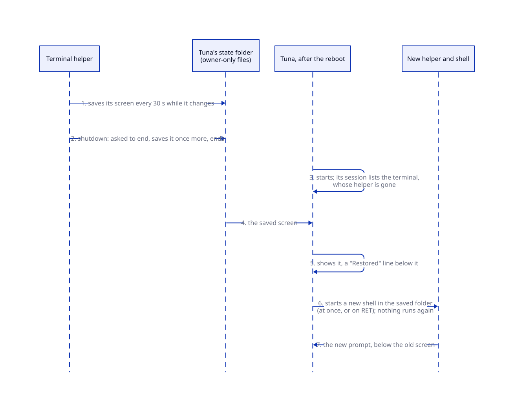

*Built (stage 5).* The helper saves the screen now and then (1) and when the shutdown asks it to end (2). After the reboot Tuna finds the terminal in its session with no helper (3), reads the saved screen (4) and shows it with the "Restored" line (5), then starts a new helper and shell in the saved folder (6), whose prompt appears below the old screen (7).

**Many terminals.** After 30 seconds without output, a terminal's scrollback is compressed, in Tuna and in its helper (`terminal-compress-after`); reading it again is transparent. Eight terminals with full 5 MB scrollbacks took 35 MB less in Tuna and 31 MB less in their helpers.

**Keys.** In semi-char mode, the default, every key goes to the program except the few Tuna keeps (`C-c`, `C-x`, `C-u`, `C-h`, `M-x`, `M-:`, `C-\`; the `keymap-exceptions` option). `C-c C-c`, `C-c C-z`, `C-c C-d` and `C-c C-\` send interrupt, suspend, end of input and quit; `C-y` pastes the newest kill, and the browser's paste key pastes the clipboard, both bracketed when the program asks. `C-q` (or `C-c C-q`) sends the next key whatever it is, the way to send `C-x` or a key the browser keeps. `C-c M-d` switches to char mode, where every key goes to the program and `M-RET` comes back. Keys go through libghostty's key encoder, so a program gets what it asked for (application cursor keys, the Kitty keyboard protocol).

**Colours** are the program's content, not Tuna's styling: the 256 palette colours are CSS variables in the plugin's `tokens.css` (the first 16 a theme's to set), and a colour a program gives exactly passes through on its text. The page script reads the colours the theme gives a terminal and tells the server, which passes them to each helper, so a program that asks for the background (vim, Claude Code, Neovim choosing light or dark) gets the theme's answer (`terminal-colors` overrides them). Every character outside ASCII is drawn exactly one or two cells wide, as the terminal engine counts it, whichever font has its glyph, so box drawing, braille graphs (btop) and icons keep their columns.

**Copy mode** (`C-c C-t`) freezes the screen so you can move over it, select and copy with Tuna's ordinary keys: the rows, scrollback included, become a read-only text in their place, coloured as before, while output goes on underneath. `M-w` copies the region as the program wrote it (lines it only wrapped are joined), `RET` copies and leaves, and any key that types leaves and goes to the program (`terminal-readonly-fast-exit`). `C-SPC` enters it with the mark at the cursor, and so does pressing and dragging over the rows, a double click, or a click in a terminal you are already in. Why a copy and not the rows themselves: Tuna's editing commands work in one text at a time, and every row is a node of its own.

**Line mode** (`C-c C-l`) lets you edit a command with Tuna's keys before the program sees it: the line you type sits over the prompt, `RET` sends it, `M-p` and `M-n` go through the lines sent. A full-screen program pauses it until it quits.

**The mouse.** A program that asks for the mouse (vim with `:set mouse=a`, htop) gets clicks, drags and the wheel, encoded as it asked; otherwise the wheel scrolls the view. **Links** that programs print (OSC 8), web addresses and `file:line` references to files that exist are underlined: a web link opens in a new browser tab, a file in its buffer at that line; `C-c C-n` and `C-c C-p` go from link to link.

**The clipboard.** `C-y` and the browser's paste key send text as a paste, bracketed when the program asks. A program may copy to the kill ring and your clipboard (OSC 52, for example Neovim or tmux over ssh) only with `terminal-enable-osc52` on, as in ghostel: any output could otherwise replace what you are about to paste. Programs can never read the clipboard.

The status line shows the program's title after the buffer's name (`terminal-status-line-format`) and the input mode when it is not semi-char.

**Programs talking to Tuna.** Programs say more than what is on the screen, in escape sequences: where a shell's prompts and commands are and how each command ended (OSC 133), "tell the user" (OSC 9 and 777), how far along they are (OSC 9;4), and their status, such as Claude Code waiting for your permission (OSC 7501, the Program Status Protocol). The terminal plugin reads them in its copy of the screen and runs a hook for each; it acts on none of them itself except prompt navigation, as ghostel's terminal does. Two small plugins answer the hooks:

- **Program status** (the `program-status` plugin, after ghostel-status) keeps each program's status records as the protocol says (a new prompt or the program ending drops "working" and "blocked", your typing drops "done" and "error", a full reset clears them) and shows the most pressing one in the status line, such as `[claude-code: blocked: permission]` or `[40%]`.
- **Notifications** (the `notifications` plugin) shows what a program asks to be told, and a status record turning blocked, done or error while you look at something else, in the echo area, as ghostel does when Emacs has no alert package. Browser notifications for a tab out of sight come later.

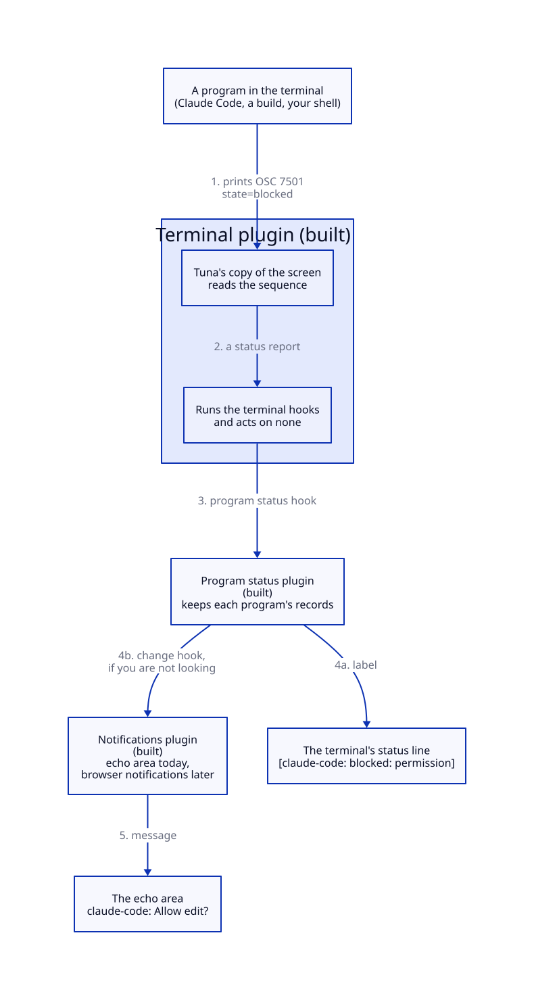

*Built (stage 4). Browser notifications are planned.* For example: Claude Code prints OSC 7501 `state=blocked` (1); Tuna's copy of the screen reads it as a status report (2) and the terminal plugin runs the program status hook (3); the program status plugin shows `[claude-code: blocked: permission]` in the status line (4a) and, if you are not looking at that terminal, runs its change hook (4b); the notifications plugin says so in the echo area (5).

**Shell integration.** bash, zsh and fish start with Tuna's integration scripts (`terminal-shell-integration`, on), without changes to your startup files: they report the folder (OSC 7), mark prompts and commands (OSC 133), and in bash and zsh set the title to the folder or the running command (`terminal-shell-integration-title`). fish 4 marks prompts itself. With the marks, `C-c M-n` and `C-c M-p` go to the next and previous prompt: they enter copy mode, with point where you typed the command (`terminal-prompt-navigation-input-mode`).

**For package authors:** the terminal contract has hooks, each with the terminal first: `terminal-title-hook` (the program set its title), `terminal-directory-hook` (it reported its folder, which also becomes the buffer's `default-directory`), `terminal-bell-hook`, `terminal-exit-hook`, `terminal-input-hook` (you sent the program input), `terminal-prompt-hook`, `terminal-command-start-hook` (with the command line) and `terminal-command-finish-hook` (with the exit code and the seconds it took), `terminal-notification-hook` (title and body), `terminal-progress-hook`, `terminal-program-status-hook` (a `program-status-report`), `terminal-program-status-clear-hook`, `terminal-reset-hook`, and `terminal-unknown-sequence-hook` (any OSC or APC sequence the engine does not know, up to `terminal-unknown-sequence-max-bytes`). The program status contract has `program-status-change-hook`, with a record's id and its value before and after. Settings, with ghostel's defaults: `terminal-shell`, `terminal-term` (`xterm-ghostty`, with the terminfo `make` builds), `terminal-environment`, `terminal-max-scrollback` (5 MB), `terminal-timer-delay`, `terminal-adaptive-fps`, `terminal-immediate-redraw-interval`, `terminal-plain-link-detection-delay`, `terminal-input-buffer-size`, `terminal-save-screen` (on), `terminal-saved-scrollback-rows` (1,000), `terminal-save-interval` (30 s), `terminal-restore-start` (`'auto` or `'key`), `terminal-restored-note`, `terminal-compress-after` (30 s), `terminal-buffer-name`, `terminal-buffer-name-function` (rename by title or folder; off), `terminal-kill-buffer-on-exit`, `terminal-query-before-killing`, `terminal-initial-input-mode` (semi-char, char or line), `terminal-scroll-on-input`, `terminal-ignore-cursor-change`, `terminal-readonly-fast-exit`, `terminal-mark-activation-input-mode`, `terminal-mouse-drag-input-mode`, `terminal-line-mode-history-size`, `terminal-enable-osc52` (off), `terminal-paste-protection` (off), `terminal-enable-url-detection`, `terminal-enable-file-detection`, `terminal-colors`, `terminal-status-line-format`, `terminal-prompt-navigation-input-mode`, `terminal-shell-integration`, `terminal-shell-integration-title`, `terminal-unknown-sequence-max-bytes`; and the program status and notifications plugins' `program-status-acknowledge-on-input`, `program-status-labels`, `program-status-show-app` and `notify-program-status-states`.

## Markdown

**Status:** built (the first stage of the [Pi chat](briefs/2026-10-agent-chat.md)); the chat that uses it is planned.

The `markdown` plugin does two things with Markdown, for text nobody vetted, such as a language model's reply:

- **Draws it.** `markdown-blocks` turns Markdown into one node per block. Paragraphs, headings, list items, quotes and code are text, so the cursor, selection and copying work on them; bold, italics, code and links are highlight spans on that text. A block's links are listed under it, and open in a new browser tab. A table is one item, drawn as a real table. Prose is in a proportional font and code in monospace, both set in the plugin's `tokens.css`.
- **Styles it as it is typed.** `markdown-style-text!` styles an editable text's own Markdown in place: headings larger, bold bold, code monospace, and the marks that make them (`#`, `**`, fences) dimmed. It styles it again after every change, so a chat's prompt looks like what it will send.

Markdown is read by md4c, a small C parser, through Tuna's own `gerbil-md4c` package. Raw HTML in the input is shown as text, never as markup, and only `http`, `https` and `mailto` links become links.

**Streaming.** Each block node remembers its place and its Markdown. `markdown-update-blocks` takes the nodes drawn last time and the longer text, keeps every node whose block has not changed, and builds the rest, so a reply streaming in redraws only its last block.

The demo shows it: `C-c m` opens `*markdown*`, a sample drawn above the same Markdown as you type it, and every change redraws the drawing.

## Where things are saved

| What | Where | When |
|---|---|---|
| Your files | Wherever they live | When you save (`C-x C-s`; built) |
| Unsaved changes | `~/.local/state/tuna/autosave/` | Every so often, and when idle |
| Open buffers, cursor positions, the layout with its frame, frame marks and pins, history, recent files, each file's remembered cursor position | `~/.local/state/tuna/session.ss` | When idle, and on exit |
| Settings changed through Tuna's UI | `~/.config/tuna/custom.ss` (planned) | When changed |
| Your configuration code | `~/.config/tuna/init.ss` | You edit it |
| The start-up report | `~/.local/state/tuna/startup.log` | Replaced on every start |
| Which terminal helpers are running, and each terminal's folder (a session slot) | `~/.local/state/tuna/session.ss` | When idle, and on exit |
| Each terminal's saved screen, for after a reboot (owner-only) | `~/.local/state/tuna/terminals/` | Every 30 s while it changes, when its helper is asked to end, and when Tuna stops |
| Terminal helpers' sockets, and a helper's log while it has something to say | `$XDG_RUNTIME_DIR/tuna/terminals/` (private to you) | While each helper runs |

Autosave, the session file, `init.ss`, and the start-up report are built. A settings screen that saves to `custom.ss`, overriding `init.ss`, comes later ([roadmap](roadmap.md)).

The saved files are plain Scheme data, readable in any editor, and Tuna never runs them as code. Only `init.ss` is code. Each plugin decides what of its own state is worth saving, and hands it to the session plugin as a named *session slot*; the kernel knows nothing about saving.

## How this differs from Emacs

See [Tuna and Emacs](emacs-equivalents.md): a table of what corresponds to what, and every deliberate difference with its reason.

## Words used here

- **Buffer**: a named piece of UI, made of a tree of nodes: a file, the minibuffer, `*Help*`, a sidebar.
- **Visiting**: a text is linked to a file; saving writes the text to it. The **visit record** on the text holds the file's name, what was on disk at the last read or save, and how its bytes became characters.
- **File service**: the replaceable layer all file reading, writing and listing goes through; today's provider is the local disk.
- **File picker**: `C-x C-f`'s completion over the files of the folder typed so far.
- **Node**: one piece of a buffer's tree; a text node holds editable text.
- **Page machinery** (the page service): what the web plugin offers other plugins on the browser page: their own scripts, their own addresses to post to, one-time instructions to one tab.
- **Speech worker**: the separate program that turns audio into text, so recognizing speech never freezes Tuna.
- **Grammar**: the list of phrases recognition is allowed to produce; for spoken commands, every command's spoken name.
- **Confidence** (of a spoken command): how little the grammar had to force what was heard, from 0 to 1, comparing its score with the free score.
- **Free score**: the score of the best transcription with no grammar, over the same audio.
- **Command**: a named action, such as `forward-char`, usually bound to a key.
- **Editor thread**: the single worker that runs commands and is the only thing allowed to change editor state.
- **Screen**: one complete drawing of what a browser tab shows, sent as HTML.
- **Text**: the characters, their properties, and undo history that a text node shows; text nodes in different buffers can show the same text.
- **View**: one place on screen showing one buffer, with its own cursor and scroll position; what Emacs calls a window.
- **Item**: one of the things a scroller lays out one after another: a text's line, a list's row, a node.
- **Scroll state**: the item at a view's top edge and how many pixels of it are above the edge, as the browser measured; what Emacs calls window-start.
- **Spacer**: an empty block in a view standing in for items not drawn, as high as they would be at the average item height the browser measured; it lets the browser's scroll bar cover the whole buffer.
- **Placement**: Tuna asking the browser, once, to put an item at the top, centre or bottom of a view.
- **Layout**: the tree of containers and views that arranges the screen, owned by a replaceable layout plugin.
- **Container**: a part of the layout that arranges its children: *fit* (split the space) or *tabbed* (one at a time), horizontal or vertical.
- **Frame**: where you're looking: a movable pointer to any part of the tree. Every tab shows the same frame.
- **Frame mark**: a saved frame location you can jump back to.
- **Pin**: a flag on a part of the layout that keeps it visible when the frame zooms past it; a **locked** pin belongs to a plugin.
- **Task**: anything that runs on the editor thread, such as a command or a timer; it may pause to wait for an answer.
- **Client**: one place you look at Tuna from; today a browser tab.
- **Tab id**: the name the server gives a page when it serves it; every request from the page carries it.
- **Per-tab state**: the three things kept for each tab, on the server and never saved: its id and connection, its keys in progress, and what its browser measured.
- **Version** (or revision): a number that goes up every time a buffer, or a part of it, changes.
- **Snapshot**: a frozen copy of a buffer's text at one version, cheap to make.
- **Job**: slow work done off the editor thread using a snapshot; it may post several results.
- **Piece**: any part of the screen with its own HTML: the screen, a view, a node, a line, a row.
- **Source** (in drawing): anything a piece can read that has a revision, which moves when it changes.
- **`memo`**: draws a piece, or reuses its last HTML when nothing it read has changed.
- **Off-thread**: running a procedure on another thread while the calling command pauses, then resuming it with the answer.
- **Source** (outside state): something outside Tuna, read on its own thread, that posts only its changes.
- **Mark**: the other end of the selection from the cursor; each view has its own.
- **Region**: the text between the mark and the cursor; Emacs's name for the selection. It is *active* while it is shown.
- **Kill ring**: Tuna's list of recently cut and copied text, which `C-y` and `M-y` paste from.
- **Plain data**: numbers, strings, symbols, booleans, and lists and vectors of them; anything crossing threads must be plain data.
- **Job group**: a plugin's set of jobs; turning the plugin off cancels them.
- **Candidate**: one thing you can choose in a list, with the text shown and the value returned.
- **Category**: what kind of thing the candidates are (`command`, `file`, `buffer`); annotations and settings key off it.
- **Session**: one running question in completion: what you have typed, the matches, and the selection.
- **Matching style**: a rule for which candidates match what you typed.
- **Annotator**: adds details beside each candidate of a category.
- **Plugin**: a bundle of commands, keys, hooks, and services that can be turned on and off.
- **Receipt**: a plugin's record of everything it added, used to undo it.
- **Service**: a swappable part of Tuna, defined by what it promises to do; one plugin fills it at a time.
- **Session owner**: the always-on owner of everything you evaluate into the running session; `reload-config` leaves it alone.
- **Kernel**: the small fixed part of Tuna that is not a plugin: the plugin machinery, the editor thread and its rules, hooks, and the slots it calls.
- **Contract**: what a service slot promises, written down so another plugin can fill it.
- **Shared library**: convenience code, such as timers and jobs, built only from the kernel's public parts.
- **Hook**: a named list of callbacks that run when something happens, such as a buffer changing or a plugin turning on.
- **Input item**: one unit of input from a browser tab, such as a key press; the kernel queues it without looking inside.
- **Package**: a directory with its own `gerbil.pkg`; Gerbil names and builds its modules together. **Concept package**: one concept's contract and default plugin, under `plugins/<concept>/`.
- **Stylesheet**: a CSS file on the page, owned by a plugin or by your `init.ss` and named, such as `(completion-list rules)`.
- **Design tokens**: the raw design scale (palette steps, sizes, fonts) as CSS custom properties, from the `stylesheets` plugin of the stylesheets package.
- **Semantic tokens**: a plugin's own CSS custom properties naming what its parts mean, such as `--completion-selected-background`, defined with design tokens.
- **Theme**: a plugin that replaces other plugins' stylesheets.
- **Terminal helper**: the small program that holds one terminal's shell and screen, outside Tuna, so the shell survives Tuna restarting.
- **Program status**: what a program in a terminal says it is doing (working, blocked on a question, done, failed), as records it reports with OSC 7501.
- **Shell integration**: small scripts a terminal's shell runs, so it tells the terminal where its prompts and commands are and which folder it is in.
- **Pseudo-terminal**: the kernel's connection between a shell and whatever shows it; when its holder exits, the shell is hung up.
- **Mirror** (of a terminal): Tuna's own copy of a terminal's screen, restored from the helper's snapshot and fed the same output, which Tuna draws from.
- **Saved screen** (of a terminal): its screen and some scrollback, which its helper saves in Tuna's state folder so the terminal can come back, restored, after a reboot.
- **Alternate screen**: the second screen a full-screen program (vim, htop) draws on, leaving the shell's scrollback alone.
- **OSC code**: an escape code a program prints to tell the terminal something (its title, its folder).
- **Span**: one timed step in a profile, such as "command self-insert-command", with what it allocated; an input item's spans form its tree.
- **Sampling**: noting, every millisecond, which code is running, to see where time goes statistically.
- **Session slot**: a named piece of one plugin's state that the session plugin saves while Tuna is idle and on exit, and hands back on the next start.
- **Markdown block**: one paragraph, heading, list, quote, code block, table or rule of a Markdown text, drawn as one node.
- **Live styling** (of Markdown): styling a text's raw Markdown in place, in its own highlight layer, again after every change.
